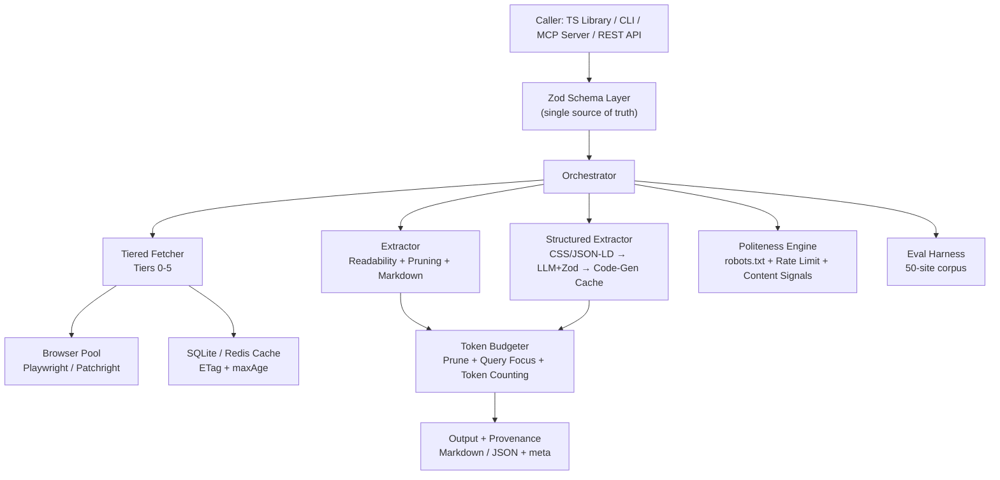

# Open-Source Project Blueprint
# Web Scraping Framework for AI Agents

> **Document:** Product & Technical Blueprint — Version 1.0
> **Date:** 21 November 2026
> **Project Owner:** [@0xOzy](https://github.com/0xOzy)
> **Status:** Research complete, ready to enter the v1 build phase
> **Recommended License:** Apache-2.0
> **Core Stack:** TypeScript-first, MCP-native, Local-first

> **Language:** **English** | [Bahasa Indonesia](./BLUEPRINT.md)

---

## Table of Contents

- [Executive Summary](#executive-summary)
- [1. Vision, Problem, and Product Positioning](#1-vision-problem-and-product-positioning)
- [2. Market Research Findings](#2-market-research-findings)
- [3. Competitor Landscape](#3-competitor-landscape)
- [4. Market Gap Analysis](#4-market-gap-analysis)
- [5. Product Definition](#5-product-definition)
- [6. Differentiation Strategy — 7 Pillars](#6-differentiation-strategy--7-pillars)
- [7. Functional Requirements & Version Scope](#7-functional-requirements--version-scope)
- [8. System Architecture](#8-system-architecture)
- [9. API Design](#9-api-design)
- [10. Data Schemas & Output Format](#10-data-schemas--output-format)
- [11. Technology Choices & Architecture Decisions (ADR)](#11-technology-choices--architecture-decisions-adr)
- [12. Token Efficiency & Evaluation Harness](#12-token-efficiency--evaluation-harness)
- [13. Indonesian / Southeast Asian Recipe Pack](#13-indonesian--southeast-asian-recipe-pack)
- [14. Ethics, Compliance, and Legal Aspects](#14-ethics-compliance-and-legal-aspects)
- [15. Security Design](#15-security-design)
- [16. Scalability, Caching, and Queues](#16-scalability-caching-and-queues)
- [17. Repository Structure & Documentation](#17-repository-structure--documentation)
- [18. 6-Week Build Roadmap](#18-6-week-build-roadmap)
- [19. Testing Strategy](#19-testing-strategy)
- [20. Portfolio & Monetization Strategy](#20-portfolio--monetization-strategy)
- [21. Risks & Mitigations](#21-risks--mitigations)
- [22. Success Metrics](#22-success-metrics)
- [23. Naming & Branding Options](#23-naming--branding-options)
- [24. Out of Scope](#24-out-of-scope)
- [Appendix A — Research Sources](#appendix-a--research-sources)
- [Appendix B — Glossary](#appendix-b--glossary)

---

## Executive Summary

The *web scraping* category is being completely transformed by AI agents. Classic scrapers return raw HTML for parsers written by humans. A scraper for agents must return **clean Markdown or schema-valid JSON, with as few tokens as possible, callable as a tool (MCP / function calling), for any URL the agent has just discovered in the middle of its task**.

Research from November 2026 shows:

1. **This category is young and highly active.** Tools created in 2024 or later are only 17 of the top 42 scraping repos, yet they hold **58% of all stars** (958.003 of 1.664.365 stars).
2. **No incumbent is complete, cheap, and simple at the same time.** Firecrawl is the API benchmark, but it is AGPL-3.0 licensed, credit-based and expensive for structured extraction, and its self-hosting is a subset of the cloud version. Crawl4AI is free, but Python-only and heavy. Scrapling is strong on stealth, but also Python-only. Jina Reader is simple, but cannot crawl.
3. **The realistic gap for a solo developer is not "better anti-bot" or "a cheaper Firecrawl cloud."** The gap is a combination: **TypeScript-first + library-first + MCP-native + measurable token efficiency + local-first with no API key + one-command self-hosting + dedicated recipes for Indonesian/Southeast Asian sites**.
4. **Honesty about anti-bot is a differentiator.** No open-source tool reliably beats Cloudflare/DataDome at scale without residential proxies — and no open-source tool ships proxy IPs. Promising "Cloudflare bypass" only invites churn, legal risk, and maintainer burnout.

**v1 recommendation (4–6 weeks, solo):** Fetching tiers 1–3 (HTTP → Readability/Trafilatura-class extraction → Playwright fallback), Markdown output + `fit`/query mode with token reporting, Zod schema-based extraction (LLM rung only), an MCP server with 5 tools, a CLI, SQLite cache, a 50-site evaluation harness, an Indonesian recipe pack (3 recipes), and one-command Docker.

**Explicitly NOT v1 goals:** proxy rotation, CAPTCHA handling, a paid cloud service, multi-browser support, and *visual agent browsing* — that last field is left to browser-use / agent-browser; this project integrates with them rather than competing.

---

## 1. Vision, Problem, and Product Positioning

### 1.1 Vision

> To become the simplest way for an AI agent to read the web: one command, no API key, clean and token-efficient results, and fully runnable on your own machine.

### 1.2 Problems Solved

| # | Problem | Impact on agent users today |
|---|---------|--------------------------------------|
| 1 | Frameworks' built-in web loaders (e.g. LangChain `WebBaseLoader`) return raw text full of navigation junk | In one measurement, ~52% of an article's 9.024 characters were navigation junk that then gets embedded into RAG |
| 2 | Hosted scraping APIs are expensive and non-transparent for structured extraction | Firecrawl: 1 credit/page base, but JSON +4 credits/page, 403/404 pages are still billed, credits do not roll over except on the Scale plan |
| 3 | Incumbent self-hosting is complicated | Firecrawl self-host = 5–6 services, without its best anti-bot engine; Crawl4AI = 1 container but needs ≥4 GB RAM |
| 4 | The best extraction frameworks are only available in Python | The agent ecosystem (Vercel AI SDK, LangChain.js, MCP TypeScript SDK) is centered on TypeScript |
| 5 | Nobody reports token costs transparently | Agents burn context windows on boilerplate; no tool makes tokens a first-class output |
| 6 | Selectors break on every site redesign | The incumbent answer: call the LLM again, pay again, forever |
| 7 | Non-English / non-US sites are neglected | Boilerplate heuristics, currency formats, and Bahasa Indonesia dates are not handled by global tools |

### 1.3 Positioning Statement

> For **developers building AI agents, RAG applications, and local personal agents** who need clean web data,
> this project is a **TypeScript-first scraping framework that is MCP-native and local-first**,
> providing **token-efficient Markdown and structured JSON from any URL, with no API key and without sending URLs to third parties**.
> Unlike Firecrawl, this project is not a credit-based API, and its self-hosting is the complete feature set, not a subset.
> Unlike Crawl4AI and Scrapling, this project is born in TypeScript and designed from a single Zod schema source for the library, MCP, CLI, and REST all at once.

### 1.4 Product Principles

1. **Local-first, no-key for core features.** Core features never require registration, a vendor API key, or telemetry.
2. **Tokens are a cost.** Every output reports the token count and the tokens saved.
3. **A single source of schema truth.** One Zod definition generates the library API, the MCP tools, the function calling definitions, and the REST API.
4. **Polite by default.** robots.txt is respected by default, per-domain rate limits are active by default, the bot identifies itself honestly.
5. **Honest about limits.** Detected as blocked = reported as `blocked`, not silently escalated with hidden costs.
6. **Finished > broad.** A small core that is finished, tested, and documented beats a Firecrawl clone with 40 half-finished features.

---

## 2. Market Research Findings

### 2.1 Why Agents Create New Demand

| Aspect | Classic Scraping (pre-2023) | Scraping for Agents (2024–2026) |
|-------|------------------------------|-----------------------------------|
| Target | A known site, manually written selectors, a cron schedule | An unknown URL at runtime — the agent discovers it via search mid-task |
| Output | Rows in a database / CSV | Context for an LLM — Markdown, citations, schema JSON |
| Failure | A missing row | The agent hallucinates, loops, or burns tokens on boilerplate |
| Caller | Code the developer wrote | An LLM choosing tools — needs a small tool surface, clear descriptions, strict schemas, actionable errors |
| Cost driver | Volume | Latency + token cost — one page read live in the middle of a conversation |

### 2.2 Behavioral Growth Signals (more defensible than TAM figures)

- **MCP became the integration layer.** MCP grew from ~2 million to **97 million SDK downloads per month by March 2026, with 10.000+ public servers** — many of them for web fetching.
- **Bots are now the majority of web readers.** Bots reached **57,5% of HTML requests in June 2026** (Cloudflare measurement). Around 25% of the top 1.000 sites now block GPTBot, up from 5% in early 2023.
- **Publishers respond with blocking and monetization.** Cloudflare launched Pay Per Crawl (HTTP 402) on 1 July 2025, Content Signals in robots.txt in September 2025, and on 15 September 2026 a new default that blocks Agent bots on ad-supported pages.
- **Star velocity.** Firecrawl gained +1.019 stars in a single day (21 Nov 2026) and +11.376 in 30 days.

### 2.3 Market Size — Read with Caution

| Definition | 2025 | 2026 | Projection | Note |
|----------|------|------|----------|---------|
| Web scraping software (narrow) | $0,99 M | **$1,17 M** | $2,28 M by 2030, CAGR 18,2–18,5% | Software license definition |
| AI-driven web scraping (broad, including services & AI tooling) | $8,24 M | **$10,20 M** | $23,70 M by 2030, CAGR 23,5% | A much broader definition |

> **Blueprint warning:** The ~10× gap between the two figures is itself the finding — vendors count different things. If you quote a market figure in the README, quote only the narrow definition ($1,17 M) together with its definition, or do not quote a TAM at all. The behavioral signals in §2.2 are far stronger for a portfolio pitch.

### 2.4 Primary Use Cases (ranked from competitor positioning evidence)

1. **RAG ingestion / documentation crawling** — crawl a docs/help site → chunked Markdown with headings, tables, citations.
2. **Agent browsing / research agents** — search → read the top results → cited synthesis; browser agents for multi-step tasks.
3. **Structured extraction for pipelines** — product, job listing, real estate, and company data as JSON Schema/Zod/Pydantic objects.
4. **Price / data monitoring** — scheduled re-scrapes + diffs (demand evidence: changedetection.io at 35.662 stars).
5. **Personal / local agents** — Claude Code / Cursor / local LLM users reading pages without sending URLs to third parties.
6. **Training / evaluation data** — large-scale clean text corpora. **Note:** this use case is under the greatest legal/publisher pressure and is **not** the use case this project advertises.

### 2.5 Warning: Stars ≠ Usage

Scrapling has 100.136 stars vs Scrapy's 65.286 stars (9 Nov 2026), but Scrapy's PyPI downloads are **4,30 million/month vs Scrapling's 0,92 million/month**. Crawl4AI: 87.124 stars / 1,28 million downloads; browser-use: 120.388 stars / 8,06 million downloads. **Implication:** this project optimizes for installs, evaluation results, and closed issues — not launch-day stars.

---

## 3. Competitor Landscape

### 3.1 Comparison Table

*Canonical snapshot: GitHub API, 9 November 2026 (via JoinMassive), so rows are comparable. Do not mix snapshots from different dates in a public README.*

| Project | Language | License | Stars (9 Nov 2026) | Core Proposition | Markdown | JS Rendering | Stealth | LLM/Schema Extraction | MCP | Self-Host |
|--------|--------|---------|-------|----------------|----------|-----------|---------|----------------------|-----|-----------|
| **Firecrawl** | TypeScript | AGPL-3.0 (SDK/MCP MIT) | 199.913 (~205.276 on 21 Nov) | Hosted web-data API: search/scrape/crawl/map/agent | ✅ Best in class | ✅ | ⚠️ Cloud-only; 33,69% on protected sites (Proxyway, Oct 2025) | ✅ JSON Schema, +4 credits/page | ✅ Separate repo 7.785★, 29 tools | ⚠️ 5–6 services, subset, no Fire-engine |
| **browser-use** | Python (+TS SDK) | MIT | 120.388 | An LLM drives the browser to complete tasks | ⚠️ Via agent actions | ✅ CDP-native since v1.0 | Cloud: stealth, residential proxies | ⚠️ Agent output schema | ⚠️ Via the ecosystem | ✅ Library; cloud for scale |
| **Scrapling** | Python | BSD-3 | 100.136 | Adaptive framework: selectors survive redesigns | ✅ | ✅ Playwright | ✅ Strongest in OSS: Patchright, TLS impersonation | ⚠️ CSS/XPath/adaptive, not LLM-schema-first | ✅ 17 tools in v0.5.1 (4 Nov 2026) | ✅ pip/Docker, a single library |
| **Playwright** | TypeScript | Apache-2.0 | 99.642 (MCP: 39.361) | The browser automation standard — the substrate, not a scraper | ❌ DIY | ✅ | ❌ Detected without patching | ❌ DIY | ✅ Microsoft MCP | ✅ Local |
| **Crawl4AI** | Python | Apache-2.0 | 87.124 | Local LLM-friendly crawler: page → `fit_markdown` | ✅ + Fit (pruning/BM25/LLM) | ✅ Playwright pool | ⚠️ 3-tier escalation; no built-in proxies | ✅ CSS + LLM via LiteLLM, Pydantic | ✅ Since v0.8 | ✅ 1 container, ≥4 GB RAM; a history of RCE advisories in its Docker API |
| **Scrapy** | Python | BSD-3 | 65.286 | Battle-tested spider framework since 2010 | ❌ DIY | ❌ Needs a plugin | ❌ DIY | ❌ Selectors/pipelines | ❌ | ✅ Library |
| **agent-browser** (Vercel Labs) | Rust CLI | Apache-2.0 | ~47.903 | A CLI for coding agents: accessibility tree snapshots + refs | ❌ Snapshot text | ✅ Chrome via CDP | ❌ Weak on Cloudflare | ❌ Interaction, not extraction | ✅ `agent-browser mcp` | ✅ Local binary |
| **Crawlee** | TypeScript | Apache-2.0 | 26.390 (Py: 9.655) | Production crawling infra: queues, autoscaling, session rotation | ❌ DIY | ✅ Playwright/Puppeteer + HTTP crawlers | ⚠️ Tiered proxies; no built-in IPs | ❌ DIY | Via Apify MCP (15.350★) | ✅ Library |
| **Jina AI Reader** | Hosted | Apache-2.0 (repo); models CC BY-NC | 12.247 | Zero-setup reader: URL prefix → clean text | ✅ | ✅ Headless by default | ❌ Does not bypass paywalls/anti-bot | ⚠️ Limited | ✅ Remote MCP | ❌ Hosted; owned by Elastic since Oct 2025 |
| **Apify** (commercial) | Platform | Closed | ~70k Actors | Ready-made scraper marketplace + cloud runs | Via Actors | ✅ | ✅ Proxy/unblocker add-ons | Via Actors | ✅ Official MCP | ❌ Cloud |
| **Bright Data** (commercial) | Platform | Closed | — | Proxy empire + Web Scraper APIs, Unlocker, datasets | Via APIs | ✅ | ✅✅ Strongest commercial; pay only for successful delivery | ✅ Ready-made collectors | ✅ Web MCP, 5.000 free req/mo | ❌ Cloud |

### 3.2 Strengths, Weaknesses, and Recurring Complaints

**Firecrawl** — *Strengths:* the widest API surface, the best DX, Py/Node/Go/Rust SDKs, a $75 million Series B (Sep 2026). *Weaknesses/complaints:* (1) credit math — 1 credit base, JSON +4, enhanced mode extra, 403/404 still billed, so the Standard plan at $99/mo (100k credits) only covers ~20k structured pages; (2) credits do not roll over except on Scale; (3) self-host ≠ cloud; (4) AGPL-3.0 hinders commercial embedding; (5) ranked last of 10 in Proxyway's protected-site test.

**Scrapling** — *Strengths:* a genuinely differentiated **adaptive selector** (element fingerprinting — tag/text/structure/siblings — and relocation after a redesign), a unified HTTP→stealth→spider API, robots.txt compliance, MCP + Agent Skill. *Weaknesses:* Python-only; `pip install scrapling` by default installs only the parser — fetchers need the `[fetchers]` extra + a browser install (a documented first-run trap); a solo-maintainer bus factor.

**Crawl4AI** — *Strengths:* free, Apache-2.0, the best token-reduction story (`fit_markdown`), deep crawl, any-LLM extraction via LiteLLM, single-container Docker. *Weaknesses:* Python-only; heavy (Playwright + ≥4 GB); documentation rated "vast/dense", setup ~1 hour; **a Docker API security history** (unauthenticated RCE via Chromium argument injection, path traversal, sandbox escape — the library itself was not affected, but it is an operational lesson); Cloud features are starting to diverge from the OSS.

**browser-use** — *Strengths:* defines the agent loop category; v1.0 (10 Nov 2026) drives Chrome directly over CDP. *Weaknesses:* **not a scraper** — non-deterministic, slow, and LLM-expensive for bulk extraction; benchmark confusion (97% is the cloud figure, 63,3% is the OSS library figure on BU Bench V1).

**agent-browser** — *Strengths:* the token-efficiency insight of 2026 — accessibility tree snapshots with short refs are far cheaper than DOM dumps or screenshots; a Rust CLI, a daemon keeps the browser alive between calls. *Weaknesses:* created in January 2026 — very young, 300+ open issues in early reviews, Vercel *Labs* status, no extraction/Markdown, weak on protected sites, opt-in security controls.

**Playwright + LangChain/LlamaIndex Loaders** — *Strengths:* Playwright is a reliable substrate; loaders are 5 lines to a prototype. *Weaknesses (measured):* `WebBaseLoader` returns ~52% navigation junk; no JS, no schema, no boilerplate removal; **`langchain-community` is being sunset** (deprecation warning on import, Oct 2026).

**Jina Reader** — *Strengths:* unbeatable time-to-first-value (a URL prefix), cheap at scale ($50 / 1 billion output tokens), 10 million free tokens per key. *Weaknesses:* **no crawl/map**, unpredictable token billing on long pages, search returns only the top 5, no interaction/login, the free tier is **non-commercial (CC BY-NC)**, commercial self-hosting of its models now requires an Elastic license.

**Crawlee / Scrapy** — *Strengths:* the only proven answers for millions of pages: queues, dedupe, autoscaling, session pools, AutoThrottle. *Weaknesses:* both are **infrastructure, not agent tools** — no Markdown, no LLM extraction, no MCP in the core; Scrapy has a real learning curve.

**Apify / Bright Data (positioning only)** — Apify: Starter $19/mo, $0,20/CU, you pay for compute **whether the run returns data or not**; Actor developers were paid $760k in January 2026 alone (marketplace monetization works). Bright Data: PAYG $1,50/1.000 records, Scale $499/mo, **pay only for successful delivery**; out of indie reach.

---

## 4. Market Gap Analysis

The following eight gaps are supported by the evidence in §3:

| # | Gap | Evidence | Opportunity for this project |
|---|-------|-------|---------------------------|
| 1 | **Self-hosting simplicity** | Firecrawl: 5–6 services & a subset; Crawl4AI: 4 GB & a Docker advisory history | A full-feature local mode in one command (`npx` / `uvx` / a single container) |
| 2 | **Cost transparency** | Credits that silently multiply (1→9 credits/page), expire, and bill 403s | A token + cost report per scrape, open, on every output |
| 3 | **Token efficiency as a product** | Everyone claims "LLM-ready", almost nobody publishes tokens/page or offers query-focused extraction by default | A first-class token budget API + a public benchmark page |
| 4 | **TypeScript-first** | The two best extraction frameworks (Crawl4AI, Scrapling) are Python-only; TS options are a hosted API, an infra library, or a thin LLM wrapper | A TS-first, MCP-native, library-first library |
| 5 | **Resilience to redesigns** | Only Scrapling (adaptive selectors) and code-gen approaches address selector rot | Code-gen extractors + adaptive relocation as a fallback |
| 6 | **The non-English / non-US web** | Benchmarks, heuristics, and examples are centered on English-language US sites | An Indonesian/SEA recipe pack (§13) |
| 7 | **Reproducible evaluation** | No major OSS project ships a public eval harness (F1, tokens, success rate, latency on a fixed corpus) | Whoever ships the eval harness owns the credibility |
| 8 | **Privacy / local-first** | Jina & Firecrawl Cloud see users' URLs; local alternatives are heavy Python stacks | A no-key, no-telemetry core that runs on a laptop |

---

## 5. Product Definition

### 5.1 Target Users

| Persona | Description | Primary need |
|---------|-----------|-----------------|
| **A. Agent Builder** | Developers building research agents, coding assistants, RAG agents with Claude Code / Cursor / agent frameworks | A reliable MCP tool, token-efficient output, errors an LLM can act on |
| **B. RAG Developer** | Developers ingesting documentation / help sites into a vector store | Site crawl + map, heading-structured Markdown, citation & provenance metadata |
| **C. Indie Hacker / ID-SEA Freelancer** | Building price monitoring, job/listing aggregators for local clients | Correct Indonesian site recipes (IDR, Bahasa dates), zero cost for repeat LLM use |
| **D. Local-LLM User** | Ollama / local model users who care about privacy | No key, no cloud, URLs never leave the machine |

### 5.2 v1 Use Cases

1. `scrape` — one URL → clean Markdown / fit Markdown.
2. `extract` — one URL + a Zod schema → valid JSON.
3. `crawl` — one domain/documentation set → many Markdown pages with depth/page limits.
4. `map` — one domain → a list of URLs (from sitemap + link discovery).
5. `watch` *(v1.5)* — URL + schema → only a semantic diff when it changes.

### 5.3 Not v1 Target Users

- Enterprise data teams needing millions of pages/day with SLAs and managed residential proxies (Apify / Bright Data territory).
- Users who need login scraping, paywall bypass, or CAPTCHA solving.
- Users who need a visual agent that clicks forms (browser-use / agent-browser territory — this project provides data, not actions).

---

## 6. Differentiation Strategy — 7 Pillars

### Pillar 1 — MCP-Native, TypeScript-First, a Single Schema Source
A single Zod schema source generates: the library API, the MCP tools, the OpenAI / Vercel AI SDK function calling definitions, and the REST API. The command `npx <nama-proyek> mcp` works in Claude Code / Cursor **with no API key** for the local core. No top-tier player is TS-first + library-first + MCP-native at the same time.

### Pillar 2 — Token Budget as a First-Class API
```ts
const result = await scrape(url, { maxTokens: 4000, query: "pricing" });
// result.markdown  -> pruned, focused on the query
// result.meta      -> { tokens, tokensSavedVsHtml, extractorUsed, tier, ms }
```
Publish a live benchmark page: tokens/page and F1 vs Firecrawl / Crawl4AI / Trafilatura on a fixed 50-site corpus. Measurable, demo-able, and it directly saves users money.

### Pillar 3 — A Full-Feature Local Mode in One Command
A single Docker container (or a single binary with bundled Chromium) contains **the entire core** — explicitly contrasted with Firecrawl's 5-service subset and Crawl4AI's 4 GB Python stack. SQLite/in-memory queues locally, Redis optional. No telemetry.

### Pillar 4 — Extract Once, Run Free Forever (Code-Gen Extraction)
First visit: LLM + Zod schema → a JSON result **and** a generated, cached deterministic extractor (CSS/JSON-LD), with Scrapling-style adaptive relocation as a fallback. Subsequent visits: **zero LLM cost**, with a confidence score; the LLM is only re-invoked when confidence drops. This turns the biggest recurring cost of the Firecrawl model (+4 credits/page, forever) into a one-time cost.

### Pillar 5 — Indonesian / Southeast Asian Recipe Pack
Tested recipes + fixtures for Indonesian public sites: correct IDR currency parsing, Bahasa Indonesia dates/boilerplate, ID locale profiles (aligned timezone/language/currency), public news/document/open-data extractors, and public e-commerce listing schemas that try the HTTP/server-rendered path before any browser. A bilingual README. No top-10 competitor has this.

### Pillar 6 — Polite-by-Default as a Feature
robots.txt + Content Signals compliance, per-domain rate limits, a signed bot identity, 402-aware stopping, and a **provenance record** on every output (source URL, fetch time, robots decision, license signals) — exactly what RAG/agent builders increasingly need for citation and audit.

### Pillar 7 — Change Monitoring for Agents
`watch(url, schema)` → scheduled re-scrapes → return only a **semantic diff** (field-level JSON diff / Markdown section diff) to the agent, not the whole page. It combines changedetection.io's proven demand (35.662★) with agent tooling, at a fraction of the full-page token cost. The best demo: a price-drop agent in 30 lines of code.

---

## 7. Functional Requirements & Version Scope

### 7.1 v1.0 — MVP (Weeks 1–6)

| Module | Requirement | Done criteria |
|-------|-----------|------------------|
| Tiered fetching | Tiers 0–3: the site's API/JSON-LD/sitemap → HTTP + TLS impersonation → reader extraction → Playwright fallback | ≥85% of test pages never launch Chromium |
| Content extraction | Readability (TS-native) + DOM pruning + HTML→Markdown conversion; `fit` mode (pruning + query-focused BM25) | Returns `tokens` and `tokensSavedVsHtml` on every result |
| Structured extraction | LLM rung only: Zod schema → server-side validation → one retry with the validation error fed back | Output is always schema-valid or a structured error |
| MCP Server | 5 tools: `scrape`, `crawl`, `map`, `extract`, `search`* (*search only if a user-configured provider exists) | The MCP configuration works in Claude Code & Cursor in <1 minute |
| CLI | `scrape`, `crawl`, `extract`, `mcp`, `eval` | One install command, no manual build steps |
| Cache | SQLite content cache with `maxAge` / ETag | RAG re-crawls do not repeat fetch+LLM costs |
| Eval harness | A fixed 50-site corpus, F1/token/latency/success metrics | The `eval` command reproduces the README benchmark table |
| ID recipes | 3 recipes: ID news, `.co.id` documents, public listings with IDR parsing | Every recipe has a fixture test (saved HTML → expected output) |
| Distribution | One-command Docker, an npm package | `docker compose up` and `npx` both verified from a clean machine |

### 7.2 v1.5 — Deepening the Differentiation (Weeks 7–10)

- Code-gen extraction (Pillar 4) with confidence scores and automatic regeneration.
- `watch` / change monitoring with semantic diffs (Pillar 7).
- A REST API (streamable HTTP) for hosted/team self-host modes, with mandatory authentication.
- Thin LangChain.js tool and LlamaIndex reader wrappers (on top of the core).
- Additional ID recipes (6–8 total) and a full Bahasa Indonesia README section.

### 7.3 v2.0 — Options After Users Exist (Not a Commitment)

- A limited hosted demo/API with a small free tier (only if organic usage appears).
- A lightweight recipe plugin marketplace in the style of Apify Actors (community recipes via the repo).
- A thin Python SDK on top of REST/MCP (not a core rewrite).

---

## 8. System Architecture

### 8.1 The Tiered Fetching Waterfall — Never Browser-First

```text
Tier 0: The site's official API / JSON-LD / RSS / sitemap / llms.txt     (cheapest, most stable)
Tier 1: HTTP fetch + TLS impersonation (undici / curl_cffi)      ~40–300 ms
Tier 2: Readability / Trafilatura-class extraction on that HTML
Tier 3: Headless browser (Playwright) — only if Tier 1 is empty / JS-gated
Tier 4: Stealth browser (Patchright / Camoufox) — only if Tier 3 is challenged
Tier 5: STOP, report blocked, optional user-supplied proxy — do NOT escalate silently
```

Rationale: browsers cost far more. In one local-LLM comparison, browserless extraction took ~42 ms/page vs 650–940 ms for browser-based readers. Publicly described 2026 production systems use the same pattern (~85% of pages never launch Chromium).

### 8.2 Component Diagram



### 8.3 Stealth Layers — What Each Layer Fixes

| Layer | Signal | Tool |
|---------|--------|------|
| Network | JA3/JA4 TLS, HTTP/2 frame ordering | curl_cffi, a real browser |
| Runtime | `navigator.webdriver`, CDP leaks (`Runtime.enable`) | **Patchright** (patched Playwright/Chromium) |
| Fingerprint | Canvas/WebGL/fonts/screen/timezone/locale | **Camoufox** (patched Firefox, C++-level fingerprint injection) |
| Behaviour | Mouse/scroll timing, pacing | Humanisation modes, jittered delays |
| Network identity | Datacenter IP reputation | Residential/mobile proxies — **supplied by the user; no OSS tool ships IPs** |

> **Blueprint rule:** All bypass percentages from small, self-run benchmarks (claims of 90–100%) are treated as *indicative only*. The only figures quoted publicly are those whose methodology is published (sites, date, rate) — e.g. Proxyway: Firecrawl at 33,69% on 15 protected sites, Oct 2025.

### 8.4 Structured Extraction — Three Rungs, in Cost Order

1. **Deterministic (free, fast, brittle):** CSS/XPath/JSON-LD/microdata. In this project: cached code-gen-generated extractors.
2. **LLM + schema (flexible, per-page LLM cost):** The shape is defined once in Zod, validated server-side, with one retry carrying the validation error. **Pruning before the LLM call is the margin.**
3. **Code generation (amortised):** The LLM writes a reusable extractor once, then Rung 1 runs forever at zero LLM cost. The most under-exploited pattern — and this project's Pillar 4.

---

## 9. API Design

### 9.1 TypeScript Library

```ts
import { scrape, crawl, extract } from "<nama-proyek>";

// 1) Scrape one page — token-efficient, query-focused
const page = await scrape("https://example.co.id/artikel", {
  maxTokens: 4000,
  query: "harga dan ketersediaan",
  fit: true,
});

page.markdown; // Clean, pruned Markdown
page.meta;     // { tokens: 1474, tokensSavedVsHtml: 15505, tier: 1,
               //   extractorUsed: "readability", ms: 212,
               //   provenance: { url, fetchedAt, robots: "allowed" } }

// 2) Structured extraction — one Zod schema
import { z } from "zod";

const Product = z.object({
  name: z.string(),
  priceIdr: z.number(),       // "Rp 1.250.000" -> 1250000 (built-in IDR parser)
  currency: z.literal("IDR"),
  inStock: z.boolean(),
});

const product = await extract("https://example.co.id/produk/123", {
  schema: Product,
  // The first visit uses an LLM; subsequent visits use the cached
  // code-gen extractor (zero LLM cost) — Pillar 4.
});

// 3) Crawl documentation for RAG
for await (const doc of crawl("https://docs.example.co.id", {
  maxPages: 100,
  maxDepth: 3,
})) {
  console.log(doc.url, doc.meta.tokens, doc.markdown.slice(0, 80));
}
```

### 9.2 MCP Server — 5 Tools

| Tool | Core inputs | Output | Structured errors for the LLM |
|------|-----------|--------|------------------------------|
| `scrape` | `url`, `maxTokens?`, `query?`, `fit?` | Markdown + token/provenance meta | `blocked`, `needs_browser`, `robots_disallowed`, `not_found` |
| `extract` | `url`, `schema` (JSON Schema from Zod) | Schema-valid JSON | `schema_validation_failed`, `blocked` |
| `crawl` | `url`, `maxPages`, `maxDepth` | A per-page result stream | `partial` + a list of failures |
| `map` | `url` | A normalized list of URLs | `no_sitemap` |
| `watch` *(v1.5)* | `url`, `schema?` | A semantic diff only | `unchanged`, `blocked` |

Principles: a **small** tool surface, tool descriptions written for an LLM (when to use, when not to), every tool accepts a token budget parameter, and errors are structured objects an agent can act on — not stack traces.

Target configuration (must work in <1 minute):

```json
{
  "mcpServers": {
    "<nama-proyek>": {
      "command": "npx",
      "args": ["-y", "<nama-proyek>", "mcp"]
    }
  }
}
```

### 9.3 CLI

```bash
npx <nama-proyek> scrape https://example.co.id/artikel --max-tokens 4000 --query "harga"
npx <nama-proyek> crawl  https://docs.example.co.id --max-pages 100 --out ./docs-md/
npx <nama-proyek> extract https://example.co.id/produk/123 --schema ./product.zod.ts
npx <nama-proyek> mcp                       # run the MCP server (stdio)
npx <nama-proyek> eval                      # run the 50-site corpus benchmark
```

### 9.4 REST API (v1.5, optional for team self-hosting)

Endpoints `POST /v1/scrape`, `POST /v1/extract`, `POST /v1/crawl`, `GET /v1/jobs/:id` — **authentication is mandatory from day one**, there is no unauthenticated mode. A direct lesson from Crawl4AI's Docker API RCE advisories and Firecrawl self-host's unauthenticated default.

---

## 10. Data Schemas & Output Format

### 10.1 The Standard Result Object

```json
{
  "url": "https://example.co.id/artikel",
  "finalUrl": "https://example.co.id/artikel",
  "status": 200,
  "markdown": "# Judul Artikel\n\n...",
  "data": null,
  "meta": {
    "tokens": 1474,
    "tokensRawHtml": 16979,
    "tokensSavedVsHtml": 15505,
    "tier": 1,
    "extractorUsed": "readability",
    "ms": 212,
    "cached": false,
    "llmCost": { "model": null, "inputTokens": 0, "outputTokens": 0 }
  },
  "provenance": {
    "fetchedAt": "2026-11-21T14:30:00+07:00",
    "robots": "allowed",
    "contentSignals": { "search": true, "aiInput": true, "aiTrain": false },
    "sourceLicenseSignals": []
  }
}
```

### 10.2 Token Efficiency Reference Figures (from a measured study, Oct 2026)

| Stage | Tokens |
|-------|-------|
| Raw HTML | 16.979 |
| After a reader (Readability/Trafilatura-class) | 4.700–5.900 |
| Trafilatura alone (test article) | 4.728 — F1 0,84 (WCXB benchmark) |
| After query-focused compression/pruning | 1.474 |

HTML→Markdown conversion alone typically cuts **80–95% of characters** (navigation/scripts/cookie banners). These figures are initial design targets; this project's official figures come from its own eval harness (§12), not from other people's studies.

### 10.3 Indonesian Locale Parsers (built into the core, not an add-on)

- **IDR currency:** `Rp 1.250.000` → `1250000` (dots are thousand separators), `Rp1,25 jt` → `1250000`, price ranges, strikethrough vs promo prices.
- **Bahasa Indonesia dates:** `21 November 2026`, `Jumat, 21 Nov 2026`, relative formats (`2 jam yang lalu`) → ISO 8601 with the `Asia/Jakarta` zone as the ID recipe default.
- **Numbers:** comma decimals (`4,8` → `4.8` for ratings), units `rb`/`jt`/`M`.
- **Bahasa boilerplate:** a list of Bahasa Indonesia navigation/footer phrases for pruning (e.g. "Beranda", "Syarat dan Ketentuan", "Hak Cipta Dilindungi").

---

## 11. Technology Choices & Architecture Decisions (ADR)

### 11.1 The Chosen Stack

| Layer | v1 choice | Reason |
|---------|-----------|--------|
| Primary language | **TypeScript** (Node.js 20+) | Fills the TS-first gap; one language for the library, MCP, CLI, REST |
| Schema | **Zod** → JSON Schema | A single source for validation, MCP tools, function calling, documentation |
| HTTP fetch | `undici` / native fetch + an optional `curl_cffi` sidecar for TLS impersonation | TLS fingerprint mismatch is the #1 cause of "the headers look right but I get a 403" |
| Article extraction | **Mozilla Readability** (TS-native) + custom DOM pruning; Trafilatura as an eval comparator | Readability is the TS-native choice; Trafilatura (Python, best F1) serves as a comparison baseline, not a dependency |
| Markdown conversion | A Turndown-class converter + table/link cleaning | Fragment fidelity after pruning |
| Browser | **Playwright** (Chromium) with a context pool; Patchright as an optional Tier 4 | The standard substrate; direct CDP is considered for v2 following the browser-use/agent-browser trend |
| MCP | The MCP TypeScript SDK, stdio transport (local) + streamable HTTP (v1.5) | Distribution via MCP registries is proven (Playwright MCP: 39.361★, 29,3 million npm downloads/mo) |
| Local queue | In-memory / SQLite | No mandatory Redis — a contrast with 5-service stacks |
| Scale queue (optional) | BullMQ + Redis | Only active when the user configures Redis |
| Cache | SQLite (local) with ETag/maxAge | The biggest single cost saver for RAG re-crawls |
| LLM provider | A provider-agnostic interface: OpenAI, Anthropic, Gemini, Ollama (local) | Users bring their own model; the core is not locked to a vendor |
| Distribution | npm (`npx`), single-container Docker | A one-line install is a star-ability requirement in this category |
| License | **Apache-2.0** | A patent grant + commercial-embedding friendliness; AGPL would cost a portfolio project stars, contributors, and commercial users |

### 11.2 ADR Summary (Architecture Decision Records)

| ADR | Decision | Rejected alternative | Reason for rejection |
|-----|-----------|--------------------------|------------------|
| ADR-001 | TypeScript-first | Python-first | The TS market gap; the agent ecosystem is centered on TS |
| ADR-002 | Library-first, MCP on top of the core | Hosted-API-first | Local-first is the differentiation; hosted can be added later |
| ADR-003 | A tiered waterfall, browser last | Browser-first (Playwright for everything) | Browser cost/latency is 10–20× HTTP |
| ADR-004 | Zod as the single schema source | Separate schemas per surface (REST/MCP/function) | Drift between surfaces is a source of bugs & stale documentation |
| ADR-005 | Stop on challenge (Tier 5) | Automatic stealth/proxy escalation | Hidden costs, DMCA §1201 risk, false expectations |
| ADR-006 | Fixture tests, not live-site tests | Testing against live sites in CI | Flaky, violates politeness, not reproducible |
| ADR-007 | Apache-2.0 | AGPL-3.0 / MIT | AGPL hinders adoption; MIT lacks an explicit patent grant |

*Each ADR is written as its own file in `docs/adr/` in the repo — evidence of an engineering process that recruiters read.*

---

## 12. Token Efficiency & Evaluation Harness

### 12.1 Why This Section Exists

No major OSS project ships a public, reproducible eval harness. Reviews rely on vendor benchmarks or one-off benchmarks. **Whoever ships the eval harness owns the credibility** — and for a portfolio project, this is the strongest differentiating artifact after the code itself.

### 12.2 Corpus Design

- **50 fixed sites**, frozen as HTML fixtures + golden outputs (reference Markdown & reference JSON).
- Corpus composition: 15 EN news/articles, 10 ID news/articles, 10 technical documentation sets, 10 product listings (including 5 ID with IDR prices), 5 mixed pages (tables, lists, FAQs).
- The corpus is stored in the repo (`eval/corpus/`) with source notes & capture dates.

### 12.3 Reported Metrics

| Metric | Definition | v1 target |
|--------|----------|-----------|
| Extraction F1 | Main-content agreement vs the golden output | ≥ the plain Readability baseline; published as-is |
| Tokens/page | Result Markdown tokens (with the tokenizer stated explicitly) | Reported per site category |
| Token saved | `1 − tokens / tokensRawHtml` | ≥70% average on the article corpus |
| Success rate | Pages producing non-empty & valid output | Reported per tier |
| Latency p50/p95 | ms per page, per tier | Tier 1 p50 < 500 ms on the corpus |
| LLM cost | LLM tokens per structured extraction; % of pages served by the code-gen cache | Decreases as the cache warms (proven in the v1.5 eval) |

### 12.4 Benchmark Publication Rules

1. One snapshot date per table — do not mix figures from different dates.
2. State the tokenizer, the comparator tool versions, and the run date.
3. Publish the bad results too. The harness's credibility is worth more than one good number.
4. Comparator benchmarks (Firecrawl/Crawl4AI/Trafilatura) are run through the same `eval` command so anyone can reproduce them.

---

## 13. Indonesian / Southeast Asian Recipe Pack

### 13.1 Rationale — and the Limits of Its Honesty

Indonesia is Southeast Asia's largest digital economy; its money use cases are price/listing monitoring on **Tokopedia (now merged with TikTok Shop), Shopee Indonesia, Blibli, Lazada ID**, travel (Traveloka, Tiket.com), and Bahasa Indonesia SERPs/local listings.

> **Research note:** No published study quantifies demand for an Indonesia-specific OSS scraping framework. This niche is **a well-reasoned bet** (supported by marketplace/proxy market evidence and platform technical reporting), not a measured market. It is therefore positioned as a *recipe pack* on top of a global core — not as the project's sole identity.

### 13.2 Technical Quirks of ID/SEA Sites That Generic Frameworks Miss

| Quirk | Detail | Design response |
|----------|--------|----------------|
| Geo-blocking | Tokopedia pricing/availability is not visible from non-ID IPs | A complete ID locale profile (user IP + aligned timezone + language + currency), not just an IP |
| Mobile-first rendering | Many ID sites are designed mobile-first | A mobile device profile on Tier 3 |
| Shopee: SSR for crawlers | Shopee has moved to client-rendered pages with a JS-signed internal API token, **but still serves a server-rendered version with complete product cards to crawlers** | HTTP-first wins: a browser is actually slower *and* easier to block — recipes try the SSR/HTTP path before a browser |
| Tokopedia data endpoints | Some data (e.g. reviews) is available via a data endpoint without rendering | Tier 0: recipes know those public endpoints |
| IDR format | `Rp 1.250.000` — dot thousand separators break naive parsers | An IDR parser in the core (§10.3) |
| 8 different Shopee marketplaces | Different domains & currencies per country, which must never be silently converted | Per-domain recipes, explicit currencies, no implicit conversion |
| Bahasa Indonesia | Boilerplate, dates, units (`rb`/`jt`) | ID locale parsers in the core (§10.3) |

### 13.3 v1 Recipes (3) and v1.5 (additional)

| # | Recipe | Version | Compliance note |
|---|-------|-------|-------------------|
| R1 | Indonesian news (Kompas/Detik-class patterns) — article extraction + ID dates | v1 | Public pages, robots respected |
| R2 | Documentation / `.co.id` sites — crawl + map for RAG | v1 | Public pages |
| R3 | Public product listing schema + IDR parser (fixture-based) | v1 | Public listing data only; no login |
| R4 | Indonesian government open data (open data portals) | v1.5 | Open data — the legally safest case |
| R5 | Travel: public search result schemas (fixture-based) | v1.5 | Public pages, strict rate limits |
| R6 | Bahasa Indonesia local SERPs/listings | v1.5 | In line with the ToS of the search provider the user uses |

**Recipe red line:** no recipe may require login, solve a CAPTCHA, or evade a paywall. A recipe that crosses this line will not be accepted as a contribution.

---

## 14. Ethics, Compliance, and Legal Aspects

*This section is a research summary, not legal advice.*

### 14.1 A Portfolio-Safe Posture

- **Public pages only, no login.**
- No paywall circumvention; no CAPTCHA solving as a headline feature.
- robots.txt **ON by default**; an honest bot identity (User-Agent + contact); respect `Crawl-delay`.
- Support **Content Signals** (`search` / `ai-input` / `ai-train`) and **stop on HTTP 402** (Pay Per Crawl) — do not evade it.
- Per-domain rate limits by default; aggressive caching.
- Document this posture in **`ETHICS.md`** — recruiters and serious users read it as a quality signal.

### 14.2 The 2026 Legal Landscape (Summary)

| Issue | Status |
|-----|--------|
| **CFAA (US)** | Scraping public, logged-out pages is unlikely to violate the CFAA after *Van Buren* (2021) / *hiQ v. LinkedIn* (9th Cir. 2022) — **but hiQ still paid a $500.000 consent judgment for breach of contract** and deleted its data |
| **Contract / ToS** | *Meta v. Bright Data* and *X v. Bright Data* (2024) were dismissed because logged-out scraping did not breach terms that only bind logged-in users — contract remains the primary risk |
| **DMCA §1201 (the new front)** | *Google v. SerpApi* (filed Dec 2025) argues that circumvention of bot defences is anti-circumvention; the DMCA claims were dismissed in July 2026 with an amended complaint pending — **unresolved, watch it** |
| **European Union** | The GDPR applies to *public* personal data too; DSM Directive Art. 4 makes a machine-readable TDM opt-out (robots.txt) legally operative for training |
| **Indonesia** | PDP Law No. 27/2022 governs personal data in scraped listings/reviews — recipes must not target personal data |
| **robots.txt** | Not a statute in the US, but respecting it is the defensible default |

### 14.3 Prompt Injection — A Scraping-Specific Risk for Agents

Page content is **untrusted input** to the agent. Mandatory design: delimit extracted content, detect & flag hidden instruction-like text where possible, and never let page text trigger a tool call directly. Document this — almost no competitor does it well.

---

## 15. Security Design

| Threat | Mandatory v1 mitigation |
|---------|-------------------|
| **SSRF** | Deny private/loopback/link-local IPs by default; validate redirects; a configurable allow/deny list |
| **RCE via browser / Docker API** | No HTTP API without authentication; never expose the Docker API; Chromium arguments from user input must be sanitized (the lesson of Crawl4AI's advisories) |
| **Injection via page content (MCP)** | Delimit untrusted content (§14.3); tools never execute instructions from a page |
| **LLM credential leakage** | LLM keys only from the user's env; never logged; never sent to the target URL |
| **Hosted demo abuse (if any)** | Hard rate limits, tiny quotas for the no-key tier, cache everything |
| **Supply chain** | Pin dependencies, audit in CI, signed releases (npm provenance) |

Urgency context: the MCP ecosystem had recorded hundreds of CVEs by late 2026 according to one registry analysis — security is not a bolt-on section, but part of this project's quality pitch.

---

## 16. Scalability, Caching, and Queues

Principle: a **Redis-optional design** — in-memory/SQLite locally, Redis when scaling. A deliberate contrast with mandatory 5-service stacks.

Scaling components (enabled progressively, not v1 prerequisites):

- **Queues:** BullMQ/Redis (TS) in team/hosted mode; request deduplication + URL normalization.
- **Content caching:** `maxAge` / ETag — the single biggest cost saver for RAG re-crawls.
- **Per-domain concurrency:** per-domain limits + AutoThrottle-style backoff on 429/403.
- **Proxy rotation (bring your own):** tiered escalation in the Crawlee pattern — start with no proxy, escalate only when blocked, always on the user's explicit configuration.
- **Browser pool:** one browser process, many contexts; health checks; hard per-page timeouts; an estimate of ~100–300 MB+ per Chromium context — document resource needs honestly.
- **Streaming results:** JSONL for large crawls; pause/resume for long crawls.
- **Observability:** per-domain success rate, cost/page, tokens/page — the same metrics as the eval harness.

---

## 17. Repository Structure & Documentation

### 17.1 Recommended Monorepo Structure

```text
<nama-proyek>/
├── README.md                  # Primary EN + a Bahasa Indonesia summary
├── ETHICS.md                  # Ethics & compliance posture (§14)
├── CHANGELOG.md               # Semver from day one
├── LICENSE                    # Apache-2.0
├── packages/
│   ├── core/                  # Tiered fetcher, extractor, token budgeter
│   ├── schema/                # Zod definitions (single source of truth)
│   ├── mcp/                   # MCP server (5 tools)
│   ├── cli/                   # CLI (scrape/crawl/extract/mcp/eval)
│   └── rest/                  # (v1.5) Authenticated REST API
├── recipes/
│   └── id/                    # Indonesian recipe pack (§13) + fixtures
├── eval/
│   ├── corpus/                # 50 frozen sites + golden outputs
│   └── README.md              # How to reproduce the benchmark
├── docs/
│   ├── adr/                   # ADR-001 to ADR-007 (§11.2)
│   ├── architecture.md
│   └── getting-started.md
├── examples/
│   ├── rag-ingestion/
│   ├── price-monitor-watch/
│   └── research-agent-mcp/
├── fixtures/                  # Saved HTML for tests (no live sites)
└── docker-compose.yml         # One command, the complete core feature set
```

### 17.2 Mandatory README Artifacts

1. **A one-line install** + a 10-second GIF: URL → clean Markdown.
2. **An MCP snippet** that works in Claude Code/Cursor in <1 minute.
3. **A benchmark table** from its own eval harness (one snapshot date, the tokenizer stated).
4. **An honest comparison** vs Firecrawl/Crawl4AI — including when you should use *them*.
5. **A bilingual summary** (English + Bahasa Indonesia).
6. Links to `ETHICS.md`, `docs/adr/`, and 3 runnable examples.

---

## 18. 6-Week Build Roadmap

Assumption: a solo developer, ±15–20 hours/week. Every week ends with something demo-able.

| Week | Focus | Verifiable deliverable |
|--------|-------|-------------------------------------|
| **1** | Foundation: monorepo, Zod schemas, Tier 1 fetch + Readability + Markdown, the `scrape` CLI | `npx … scrape <url>` produces Markdown + token meta from a clean machine |
| **2** | Pruning & tokens: `fit` mode, query focus (BM25), token counting, ID locale parsers (IDR/dates) | A token-savings demo on 5 ID articles; the IDR parser test passes its fixtures |
| **3** | Browser & crawl: Tier 3 Playwright fallback, a simple browser pool, `crawl` + `map`, SQLite cache | A 100-page documentation crawl with ≥85% of pages served without Chromium |
| **4** | Structured extraction: the LLM rung + Zod, validation + retry, a multi-provider LLM interface (including Ollama) | `extract` produces valid JSON for 3 example schemas |
| **5** | MCP & ID recipes: an MCP server with 5 tools, recipes R1–R3 + fixture tests, `ETHICS.md`, SSRF protection | MCP works in Claude Code & Cursor; 3 recipes pass their fixtures |
| **6** | Eval & launch: the 50-site harness, the README benchmark table, one-command Docker, a demo GIF, CHANGELOG v1.0.0 | `eval` reproduces the README table; the v1.0.0 release; a launch post (Show HN / local community) |

**Realistic buffer:** if a week slips, cut in this order first: (1) Tier 4 stealth, (2) recipe R3, (3) the REST API. Do not cut the eval harness — it is the differentiator.

---

## 19. Testing Strategy

| Test type | Coverage | Note |
|------------|---------|---------|
| Unit | IDR/ID date parsers, URL normalization, pruning, token counting, robots compliance | Fast, no network |
| Fixture (golden) | Saved HTML → expected Markdown/JSON, per recipe & per tier | The backbone of CI — **no tests against live sites in CI** |
| Integration | MCP server: invoke the 5 tools via a real MCP client | Verify the Zod schema ↔ JSON Schema contract |
| Eval (not daily CI) | The 50-site corpus (§12) | Run manually / weekly; results committed as a report |
| Security | SSRF (private IPs, malicious redirects), browser argument injection, content delimitation | A mandatory release checklist |

---

## 20. Portfolio & Monetization Strategy

### 20.1 How Similar Projects Monetize (for context, not to copy blindly)

| Model | Who | Mechanics |
|-------|-------|---------|
| Open-core hosted API | Firecrawl | An AGPL core (subset) → cloud credits at $19–$749/mo; the anti-bot engine & Agent are cloud-only; Series A $14,5 jt → Series B $75 jt (Sep 2026) |
| OSS library → cloud | Crawl4AI, browser-use, Crawlee→Apify | A free library builds distribution; the cloud sells browsers, proxies, CAPTCHA, scheduling |
| Marketplace take-rate | Apify | The platform takes a cut of compute + Actor fees; $760 rb was paid to Actor developers in January 2026 alone |
| Token packs (utility pricing) | Jina (Elastic) | $50 / 1 billion tokens |
| Proxies / unblocking (where the real money is) | Bright Data, Oxylabs | $1,50/1.000 records PAYG up to $499+ commitments; datasets sold separately |
| Sponsorships only | Scrapling, Scrapy | GitHub Sponsors + sponsor slots in the README (proxy companies are the recurring sponsors — note the conflict-of-interest optics) |

### 20.2 A Realistic Sequence for a Solo Developer

1. **Portfolio/consulting income first** — the repo *is* the credential (an ID-SEA freelance signal from the recipe pack).
2. **GitHub Sponsors** + a paid hosted demo/API with a free tier — **only if organic usage appears**.
3. **Paid recipes/templates/support**, or a niche SaaS built *on top of* the framework (e.g. ID e-commerce price monitoring).
4. **Do not build** proxy infrastructure or a CAPTCHA service — capital-intensive, legally exposed, and not legible as a portfolio.

### 20.3 What Makes This Repo Attractive to Recruiters / Clients

- **Architecture evidence:** the tiered waterfall diagram, ADRs, a clean monorepo (core/MCP/CLI/SDK).
- **Engineering rigour:** the eval harness + CI benchmarks, fixture-based tests, end-to-end type-safe schemas (Zod → JSON Schema → MCP from one source), one-command Docker, an explicit security posture.
- **Product sense:** `ETHICS.md` + robots.txt defaults, transparent per-scrape cost/token reporting, good errors for agents.
- **Distribution artefacts:** a bilingual README, 3 working examples, a short demo video, a changelog + semver from day one.
- **Scope discipline:** a small, finished, well-tested core beats a sprawling, half-finished Firecrawl clone.

---

## 21. Risks & Mitigations

| Risk | Severity | Mitigation |
|--------|-----------|----------|
| Legal — ToS/contract (hiQ won on the CFAA, lost $500 rb on contract) | High if marketing "scrape any site" | A public-pages-only position, robots ON by default, no login scraping, `ETHICS.md`, a not-legal-advice disclaimer |
| Legal — DMCA §1201 (Google/Reddit v. SerpApi, unresolved in 2026) | Rising | Do not headline CAPTCHA/anti-bot *circumvention*; frame stealth as "renders JS like a browser"; stop on challenge by default |
| Legal — privacy (GDPR, Indonesia's PDP Law) | Medium | No personal-data recipes; warnings on reviews/profiles; data minimisation by default |
| Publisher countermeasures (Pay Per Crawl, Content Signals, default Agent blocking since Sep 2026) | Structural | Honour 402/Content Signals; identify the bot; design for permission, not just evasion |
| Maintenance burden (browser upgrades, site churn, the anti-bot arms race — the #1 killer of solo scraping projects) | High | The tiered design isolates browser/stealth; fixture tests; adaptive/code-gen extraction; an explicit out-of-scope list |
| Security (SSRF, browser RCE, MCP tool injection via page content) | High | Authentication on any HTTP API, no unauthenticated defaults, deny private IPs for SSRF, delimit untrusted content, pin dependencies |
| Hosted demo cost / abuse | Medium | Hard rate limits, tiny no-key quotas, cache everything |
| License choice | A one-way door | MIT or Apache-2.0 (this blueprint chooses Apache-2.0); AGPL costs stars, contributors, and commercial users |
| The star-chasing trap (Scrapling: 100 rb★ but 0,92 jt downloads vs Scrapy's 4,3 jt) | Medium | Optimize for installs, eval results, and closed issues — not launch-day stars |

---

## 22. Success Metrics

### 22.1 v1 Release Metrics (launch gate)

- [ ] A one-line install works from a clean machine (npm + Docker).
- [ ] MCP connects in Claude Code & Cursor in <1 minute following the README.
- [ ] The eval harness runs and the README benchmark table is reproducible from the `eval` command.
- [ ] 3 ID recipes pass their fixture tests; the IDR parser passes all test cases (§10.3).
- [ ] No unauthenticated API path; the SSRF tests pass.

### 22.2 90-Day Post-Launch Metrics

| Dimension | Indicator | Initial target (realistic, not a promise) |
|---------|-----------|--------------------------------------|
| Adoption | Weekly npm downloads, unique clones | An upward trend for 4 consecutive weeks |
| Quality | Success rate & F1 on the eval corpus | No regression between releases |
| Community | Closed issues, the first external PR, discussions | The first external PR within 90 days |
| Portfolio | Freelance/project offers that mention this repo | ≥1 client conversation sourced from the repo |
| Content | Demo articles/videos linking to the repo | 2–3 artefacts in 90 days |

---

## 23. Naming & Branding Options

Criteria: available on npm, no collision with major players, globally readable, and signals "for agents".

| Option | Feel | Initial-check note* |
|------|--------|---------------------------|
| **AgentFetch** | Direct, descriptive | Generic — check npm/GitHub conflicts manually |
| **ScrapeKit** | A TS toolkit | A friendly developer-tool tone |
| **WebLens** | Reading the web for agents | Short, memorable |
| **Trawlr** | A homage to Trafilatura + crawler | Unique, but the spelling needs education |
| **AmbilWeb** | Bahasa Indonesia ("ambil" = fetch) | A strong local brand, a global-readability risk |

> *Name availability (npm, GitHub org, domain, trademark) has **not been verified** in this research and must be checked manually before any announcement. Recommended process: pick 1 primary name + 1 backup, secure npm & GitHub on the same day.

---

## 24. Out of Scope

This list is a product decision, not a shortcoming. It is included in the public README so user and contributor expectations are aligned.

| Not built | Reason | Directed alternative |
|----------------|--------|---------------------------|
| Proxy rotation & IP provisioning | Capital-intensive, legally exposed, not a portfolio | Users bring their own proxy (Tier 5) |
| CAPTCHA solving | The DMCA §1201 legal front; an arms race | Stop & report `blocked` |
| Login / paywall scraping | Contract & privacy risk | — |
| Visual agent browsing (clicks/forms) | A different category, strong players already exist | Integration with browser-use / agent-browser |
| A paid cloud service (v1) | Focus on OSS distribution first | One-command self-hosting |
| Multi-browser support (v1) | Maintenance burden | Chromium only; Firefox via Camoufox as an optional Tier 4 only |
| Large-scale training data collection | The highest legal/publisher pressure | — |

---

## Appendix A — Research Sources

This blueprint was compiled from an in-depth research report dated 21 November 2026 (a GitHub API snapshot of 9 November 2026 for the competitor table, via JoinMassive, verified directly during the research). Star counts move daily — **re-verify on GitHub before quoting any figure in a public README**.

**Canonical / comparison**
- JoinMassive — *Open-Source Web Scraping Tools* (42 repos, GitHub API 9 Nov 2026) and *Web Scraping MCP Server* (Nov 2026)

**Market / MCP / policy**
- The Business Research Company — web scraping & AI-driven web scraping market reports
- AffDuDe — web scraping statistics (Cloudflare measurements, bot share)
- Coronium — *Scraping in the Agentic Era: MCP 2026*
- ScrapingAgency — a guide to Cloudflare's 2026 AI bot rules

**Technical**
- Robertz.co — a comparison of open-source scrapers for local LLMs (latency & tokens)
- MagpieScraper — a LangChain scraping guide (the WebBaseLoader navigation-junk measurement)
- Automation Techinz — Playwright stealth mode 2026 (Patchright/Camoufox benchmarks — *indicative only*)
- Proxyway (Oct 2025) — a test of scraping APIs on protected sites (published methodology)

**Legal** *(summaries, not legal advice)*
- WebScraping.ai — *Is Web Scraping Legal?*
- CrawlRelay — a web scraping legality guide

**Southeast Asia**
- DEV (Matvey G.) — *Scraping Southeast Asian Marketplaces in 2026: Shopee & Tokopedia*
- KrawlX — an e-commerce scraping guide

**Acknowledged research limitations**
- No hands-on testing of any tool was performed; feature claims rest on project READMEs/documentation and dated independent reviews.
- Anti-bot bypass percentages from small, self-run benchmarks are indicative only.
- Market-size figures from different vendors are definitionally incompatible.
- Indonesia-specific framework demand has not been quantified in any published study — it is treated as a well-reasoned bet.

---

## Appendix B — Glossary

| Term | Meaning |
|---------|------|
| **MCP (Model Context Protocol)** | An open protocol for LLMs/agents to call external tools (scrape, extract, etc.) with standardized schemas |
| **RAG** | Retrieval-Augmented Generation — retrieving relevant documents as context for an LLM's answer |
| **Fit Markdown** | Markdown that has been pruned/focused (boilerplate removed, optionally focused on a query) to save tokens |
| **Tier (fetching)** | An escalation level for fetching a page, from cheap HTTP to a stealth browser |
| **Adaptive selector** | A selector that relocates an element from its fingerprint after a site redesign |
| **Code-gen extraction** | An LLM generates a deterministic extractor once, then that extractor is reused without the LLM |
| **Content Signals** | Signals in robots.txt stating content-use permissions for search / ai-input / ai-train |
| **Pay Per Crawl** | Cloudflare's mechanism (HTTP 402) for publishers to charge per AI bot crawl |
| **Provenance** | A record of a scrape result's origin: URL, time, robots decision, license signals |
| **SSRF** | Server-Side Request Forgery — an attack that forces a server to request internal/dangerous URLs |

---

*— End of Blueprint v1.0 —*

*Recommended next documents: (1) ADR-001 to ADR-007 as separate files, (2) the v1 Zod schema specification, (3) the 50-site eval corpus list.*
