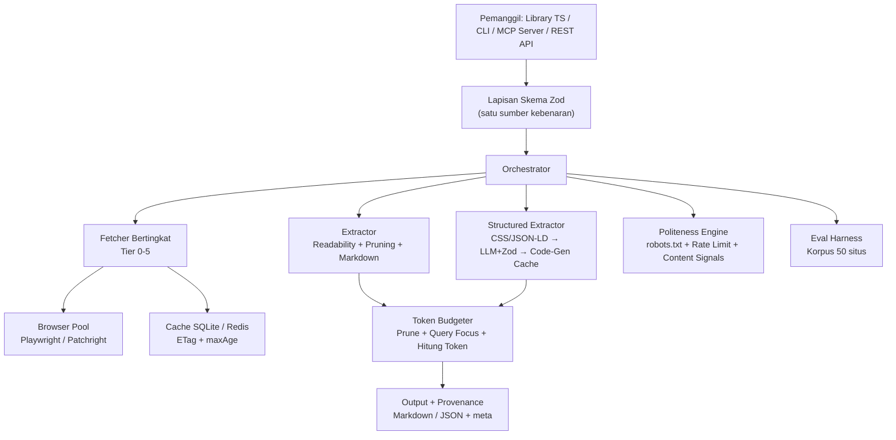

# Blueprint Proyek Open-Source
# Web Scraping Framework untuk AI Agent

> **Dokumen:** Blueprint Produk & Teknis — Versi 1.0
> **Tanggal:** 21 November 2026
> **Pemilik Proyek:** [@0xOzy](https://github.com/0xOzy)
> **Status:** Riset selesai, siap masuk fase pembangunan v1
> **Lisensi yang Direkomendasikan:** Apache-2.0
> **Stack Utama:** TypeScript-first, MCP-native, Local-first

---

## Daftar Isi

- [Ringkasan Eksekutif](#ringkasan-eksekutif)
- [1. Visi, Masalah, dan Posisi Produk](#1-visi-masalah-dan-posisi-produk)
- [2. Temuan Riset Pasar](#2-temuan-riset-pasar)
- [3. Lanskap Kompetitor](#3-lanskap-kompetitor)
- [4. Analisis Celah Pasar (Gap Analysis)](#4-analisis-celah-pasar-gap-analysis)
- [5. Definisi Produk](#5-definisi-produk)
- [6. Strategi Diferensiasi — 7 Pilar](#6-strategi-diferensiasi--7-pilar)
- [7. Kebutuhan Fungsional & Ruang Lingkup Versi](#7-kebutuhan-fungsional--ruang-lingkup-versi)
- [8. Arsitektur Sistem](#8-arsitektur-sistem)
- [9. Desain API](#9-desain-api)
- [10. Skema Data & Format Output](#10-skema-data--format-output)
- [11. Pilihan Teknologi & Keputusan Arsitektur (ADR)](#11-pilihan-teknologi--keputusan-arsitektur-adr)
- [12. Efisiensi Token & Harness Evaluasi](#12-efisiensi-token--harness-evaluasi)
- [13. Paket Resep Indonesia / Asia Tenggara](#13-paket-resep-indonesia--asia-tenggara)
- [14. Etika, Kepatuhan, dan Aspek Hukum](#14-etika-kepatuhan-dan-aspek-hukum)
- [15. Desain Keamanan](#15-desain-keamanan)
- [16. Skalabilitas, Caching, dan Antrian](#16-skalabilitas-caching-dan-antrian)
- [17. Struktur Repositori & Dokumentasi](#17-struktur-repositori--dokumentasi)
- [18. Roadmap Pembangunan 6 Minggu](#18-roadmap-pembangunan-6-minggu)
- [19. Strategi Pengujian](#19-strategi-pengujian)
- [20. Strategi Portofolio & Monetisasi](#20-strategi-portofolio--monetisasi)
- [21. Risiko & Mitigasi](#21-risiko--mitigasi)
- [22. Metrik Keberhasilan](#22-metrik-keberhasilan)
- [23. Opsi Nama & Branding](#23-opsi-nama--branding)
- [24. Di Luar Ruang Lingkup (Out of Scope)](#24-di-luar-ruang-lingkup-out-of-scope)
- [Lampiran A — Sumber Riset](#lampiran-a--sumber-riset)
- [Lampiran B — Glosarium](#lampiran-b--glosarium)

---

## Ringkasan Eksekutif

Kategori *web scraping* sedang berubah total karena AI agent. Scraper klasik mengembalikan HTML mentah untuk parser yang ditulis manusia. Scraper untuk agent harus mengembalikan **Markdown bersih atau JSON yang valid terhadap skema, dengan jumlah token seminimal mungkin, dapat dipanggil sebagai tool (MCP / function calling), untuk URL apa pun yang baru ditemukan agent di tengah tugasnya**.

Riset November 2026 menunjukkan:

1. **Kategori ini muda dan sangat aktif.** Tools yang dibuat pada 2024 atau sesudahnya hanya 17 dari 42 repo scraping teratas, tetapi memegang **58% dari seluruh stars** (958.003 dari 1.664.365 stars).
2. **Tidak ada incumbent yang lengkap sekaligus murah dan sederhana.** Firecrawl adalah patokan API, tetapi berlisensi AGPL-3.0, berbasis kredit yang mahal untuk ekstraksi terstruktur, dan self-hosting-nya adalah subset dari versi cloud. Crawl4AI gratis, tetapi Python-only dan berat. Scrapling kuat di stealth, tetapi juga Python-only. Jina Reader sederhana, tetapi tidak bisa crawl.
3. **Celah yang realistis untuk developer solo bukan "anti-bot lebih jago" atau "cloud Firecrawl lebih murah".** Celahnya adalah kombinasi: **TypeScript-first + library-first + MCP-native + efisiensi token yang terukur + local-first tanpa API key + self-host satu perintah + resep khusus situs Indonesia/Asia Tenggara**.
4. **Kejujuran soal anti-bot adalah diferensiasi.** Tidak ada tool open-source yang andal mengalahkan Cloudflare/DataDome dalam skala besar tanpa proxy residential — dan tidak ada tool open-source yang menyediakan IP proxy. Menjanjikan "Cloudflare bypass" hanya mengundang churn, risiko hukum, dan kelelahan maintainer.

**Rekomendasi v1 (4–6 minggu, solo):** Tier fetching 1–3 (HTTP → ekstraksi Readability/Trafilatura-class → fallback Playwright), output Markdown + mode `fit`/query dengan laporan token, ekstraksi berbasis skema Zod (rung LLM saja), MCP server dengan 5 tools, CLI, cache SQLite, harness evaluasi 50 situs, paket resep Indonesia (3 resep), dan Docker satu perintah.

**Yang secara eksplisit BUKAN tujuan v1:** rotasi proxy, penanganan CAPTCHA, layanan cloud berbayar, dukungan multi-browser, dan *visual agent browsing* — bidang terakhir diserahkan ke browser-use / agent-browser, proyek ini berintegrasi dengan mereka, bukan bersaing.

---

## 1. Visi, Masalah, dan Posisi Produk

### 1.1 Visi

> Menjadi cara paling sederhana bagi AI agent untuk membaca web: satu perintah, tanpa API key, hasil bersih dan hemat token, dan dapat dijalankan sepenuhnya di mesin sendiri.

### 1.2 Masalah yang Diselesaikan

| # | Masalah | Dampak bagi pengguna agent saat ini |
|---|---------|--------------------------------------|
| 1 | Loader web bawaan framework (mis. LangChain `WebBaseLoader`) mengembalikan teks mentah penuh sampah navigasi | Pada satu pengukuran, ~52% dari 9.024 karakter artikel adalah sampah navigasi yang kemudian ikut di-embed ke RAG |
| 2 | API scraping hosted mahal dan tidak transparan untuk ekstraksi terstruktur | Firecrawl: 1 kredit/halaman dasar, tetapi JSON +4 kredit/halaman, halaman 403/404 tetap ditagih, kredit tidak roll-over kecuali paket Scale |
| 3 | Self-hosting incumbent rumit | Firecrawl self-host = 5–6 service, tanpa mesin anti-bot terbaiknya; Crawl4AI = 1 container tetapi butuh ≥4 GB RAM |
| 4 | Framework ekstraksi terbaik hanya tersedia di Python | Ekosistem agent (Vercel AI SDK, LangChain.js, MCP TypeScript SDK) berpusat di TypeScript |
| 5 | Tidak ada yang melaporkan biaya token secara transparan | Agent membakar context window untuk boilerplate; tidak ada tool yang menjadikan token sebagai output kelas satu |
| 6 | Selector rusak setiap situs redesign | Jawaban incumbent: panggil LLM lagi, bayar lagi, selamanya |
| 7 | Situs non-Inggris / non-AS terabaikan | Heuristik boilerplate, format mata uang, dan tanggal Bahasa Indonesia tidak ditangani tool global |

### 1.3 Pernyataan Posisi (Positioning Statement)

> Untuk **developer yang membangun AI agent, aplikasi RAG, dan personal agent lokal** yang membutuhkan data web yang bersih,
> proyek ini adalah **framework scraping TypeScript-first yang MCP-native dan local-first**,
> yang memberikan **Markdown hemat token dan JSON terstruktur dari URL apa pun, tanpa API key dan tanpa mengirim URL ke pihak ketiga**.
> Berbeda dengan Firecrawl, proyek ini bukan API berbasis kredit dan self-host-nya adalah fitur lengkap, bukan subset.
> Berbeda dengan Crawl4AI dan Scrapling, proyek ini lahir di TypeScript dan dirancang dari satu sumber skema Zod untuk library, MCP, CLI, dan REST sekaligus.

### 1.4 Prinsip Produk

1. **Local-first, no-key untuk fitur inti.** Fitur inti tidak pernah mewajibkan registrasi, API key vendor, atau telemetri.
2. **Token adalah biaya.** Setiap output melaporkan jumlah token dan token yang dihemat.
3. **Satu sumber kebenaran skema.** Satu definisi Zod menghasilkan API library, tools MCP, definisi function calling, dan REST API.
4. **Polite by default.** robots.txt dihormati secara default, rate limit per domain aktif secara default, bot teridentifikasi dengan jujur.
5. **Jujur soal batas.** Terdeteksi diblokir = dilaporkan sebagai `blocked`, bukan diam-diam dieskalasi dengan biaya tersembunyi.
6. **Selesai > luas.** Inti kecil yang selesai, teruji, dan terdokumentasi mengalahkan klon Firecrawl dengan 40 fitur setengah jadi.

---

## 2. Temuan Riset Pasar

### 2.1 Mengapa Agent Menciptakan Permintaan Baru

| Aspek | Scraping Klasik (pra-2023) | Scraping untuk Agent (2024–2026) |
|-------|------------------------------|-----------------------------------|
| Target | Situs yang sudah dikenal, selector ditulis manual, jadwal cron | URL tidak dikenal saat runtime — agent menemukannya lewat search di tengah tugas |
| Output | Baris di database / CSV | Konteks untuk LLM — Markdown, sitasi, JSON skema |
| Kegagalan | Baris hilang | Agent berhalusinasi, looping, atau membakar token untuk boilerplate |
| Pemanggil | Kode yang ditulis developer | LLM yang memilih tool — butuh permukaan tool kecil, deskripsi jelas, skema ketat, error yang dapat ditindaklanjuti |
| Penggerak biaya | Volume | Latensi + biaya token — satu halaman dibaca langsung di tengah percakapan |

### 2.2 Sinyal Pertumbuhan Perilaku (lebih dapat dipertahankan daripada angka TAM)

- **MCP menjadi lapisan integrasi.** MCP tumbuh dari ~2 juta menjadi **97 juta unduhan SDK per bulan pada Maret 2026, dengan 10.000+ server publik** — banyak di antaranya untuk web fetching.
- **Bot kini mayoritas pembaca web.** Bot mencapai **57,5% dari request HTML pada Juni 2026** (pengukuran Cloudflare). Sekitar 25% dari 1.000 situs teratas kini memblokir GPTBot, naik dari 5% di awal 2023.
- **Publisher merespons dengan blokir dan monetisasi.** Cloudflare meluncurkan Pay Per Crawl (HTTP 402) pada 1 Juli 2025, Content Signals di robots.txt pada September 2025, dan pada 15 September 2026 default baru yang memblokir bot Agent di halaman beriklan.
- **Kecepatan stars.** Firecrawl memperoleh +1.019 stars dalam satu hari (21 Nov 2026) dan +11.376 dalam 30 hari.

### 2.3 Ukuran Pasar — Baca dengan Hati-hati

| Definisi | 2025 | 2026 | Proyeksi | Catatan |
|----------|------|------|----------|---------|
| Software web scraping (sempit) | $0,99 M | **$1,17 M** | $2,28 M pada 2030, CAGR 18,2–18,5% | Definisi lisensi software |
| AI-driven web scraping (luas, termasuk layanan & AI tooling) | $8,24 M | **$10,20 M** | $23,70 M pada 2030, CAGR 23,5% | Definisi jauh lebih luas |

> **Peringatan blueprint:** Selisih ~10× antara kedua angka adalah temuan itu sendiri — vendor menghitung hal yang berbeda. Jika mengutip angka pasar di README, kutip hanya definisi sempit ($1,17 M) beserta definisinya, atau jangan kutip TAM sama sekali. Sinyal perilaku di §2.2 jauh lebih kuat untuk pitch portofolio.

### 2.4 Kasus Penggunaan Utama (diurutkan dari bukti posisi kompetitor)

1. **Ingesti RAG / crawling dokumentasi** — crawl situs docs/help → Markdown ter-chunk dengan heading, tabel, sitasi.
2. **Agent browsing / research agent** — search → baca hasil teratas → sintesis bersitasi; browser agent untuk tugas multi-langkah.
3. **Ekstraksi terstruktur untuk pipeline** — data produk, lowongan, properti, perusahaan sebagai objek JSON Schema/Zod/Pydantic.
4. **Monitoring harga / data** — scrape ulang terjadwal + diff (bukti demand: changedetection.io 35.662 stars).
5. **Personal / local agent** — pengguna Claude Code / Cursor / LLM lokal membaca halaman tanpa mengirim URL ke pihak ketiga.
6. **Data training / evaluasi** — korpus teks bersih skala besar. **Catatan:** kasus ini berada di bawah tekanan hukum/publisher terbesar dan **bukan** kasus yang diiklankan proyek ini.

### 2.5 Peringatan: Stars ≠ Penggunaan

Scrapling memiliki 100.136 stars vs Scrapy 65.286 stars (9 Nov 2026), tetapi unduhan PyPI Scrapy **4,30 juta/bulan vs Scrapling 0,92 juta/bulan**. Crawl4AI: 87.124 stars / 1,28 juta unduhan; browser-use: 120.388 stars / 8,06 juta unduhan. **Implikasi:** optimasi proyek ini adalah untuk instalasi, hasil evaluasi, dan issue yang selesai — bukan stars hari peluncuran.

---

## 3. Lanskap Kompetitor

### 3.1 Tabel Perbandingan

*Snapshot kanonis: GitHub API, 9 November 2026 (via JoinMassive), agar antar-baris dapat dibandingkan. Jangan mencampur snapshot tanggal berbeda di README publik.*

| Proyek | Bahasa | Lisensi | Stars (9 Nov 2026) | Proposisi Inti | Markdown | Render JS | Stealth | Ekstraksi LLM/Skema | MCP | Self-Host |
|--------|--------|---------|-------|----------------|----------|-----------|---------|----------------------|-----|-----------|
| **Firecrawl** | TypeScript | AGPL-3.0 (SDK/MCP MIT) | 199.913 (~205.276 pada 21 Nov) | Hosted web-data API: search/scrape/crawl/map/agent | ✅ Terbaik | ✅ | ⚠️ Cloud-only; 33,69% di situs terproteksi (Proxyway, Okt 2025) | ✅ JSON Schema, +4 kredit/halaman | ✅ Repo terpisah 7.785★, 29 tools | ⚠️ 5–6 service, subset, tanpa Fire-engine |
| **browser-use** | Python (+TS SDK) | MIT | 120.388 | LLM mengemudikan browser untuk menyelesaikan tugas | ⚠️ Via aksi agent | ✅ CDP-native sejak v1.0 | Cloud: stealth, proxy residential | ⚠️ Skema output agent | ⚠️ Via ekosistem | ✅ Library; cloud untuk skala |
| **Scrapling** | Python | BSD-3 | 100.136 | Framework adaptif: selector bertahan dari redesign | ✅ | ✅ Playwright | ✅ Terkuat di OSS: Patchright, TLS impersonation | ⚠️ CSS/XPath/adaptif, bukan LLM-schema-first | ✅ 17 tools di v0.5.1 (4 Nov 2026) | ✅ pip/Docker, satu library |
| **Playwright** | TypeScript | Apache-2.0 | 99.642 (MCP: 39.361) | Standar otomasi browser — substrat, bukan scraper | ❌ DIY | ✅ | ❌ Terdeteksi tanpa patch | ❌ DIY | ✅ MCP Microsoft | ✅ Lokal |
| **Crawl4AI** | Python | Apache-2.0 | 87.124 | Crawler lokal LLM-friendly: page → `fit_markdown` | ✅ + Fit (pruning/BM25/LLM) | ✅ Playwright pool | ⚠️ Eskalasi 3 tingkat; tanpa proxy bawaan | ✅ CSS + LLM via LiteLLM, Pydantic | ✅ Sejak v0.8 | ✅ 1 container, ≥4 GB RAM; riwayat advisory RCE di Docker API |
| **Scrapy** | Python | BSD-3 | 65.286 | Framework spider battle-tested sejak 2010 | ❌ DIY | ❌ Perlu plugin | ❌ DIY | ❌ Selector/pipeline | ❌ | ✅ Library |
| **agent-browser** (Vercel Labs) | Rust CLI | Apache-2.0 | ~47.903 | CLI untuk coding agent: snapshot accessibility tree + refs | ❌ Teks snapshot | ✅ Chrome via CDP | ❌ Lemah di Cloudflare | ❌ Interaksi, bukan ekstraksi | ✅ `agent-browser mcp` | ✅ Binary lokal |
| **Crawlee** | TypeScript | Apache-2.0 | 26.390 (Py: 9.655) | Infra crawling produksi: antrian, autoscaling, rotasi sesi | ❌ DIY | ✅ Playwright/Puppeteer + HTTP crawler | ⚠️ Proxy bertingkat; tanpa IP bawaan | ❌ DIY | Via Apify MCP (15.350★) | ✅ Library |
| **Jina AI Reader** | Hosted | Apache-2.0 (repo); model CC BY-NC | 12.247 | Reader zero-setup: prefix URL → teks bersih | ✅ | ✅ Headless default | ❌ Tidak bypass paywall/anti-bot | ⚠️ Terbatas | ✅ Remote MCP | ❌ Hosted; dimiliki Elastic sejak Okt 2025 |
| **Apify** (komersial) | Platform | Tertutup | ~70 rb Actors | Marketplace scraper siap pakai + cloud runs | Via Actors | ✅ | ✅ Proxy/unblocker add-on | Via Actors | ✅ MCP resmi | ❌ Cloud |
| **Bright Data** (komersial) | Platform | Tertutup | — | Kekaisaran proxy + Web Scraper API, Unlocker, dataset | Via API | ✅ | ✅✅ Terkuat komersial; bayar hanya untuk pengiriman sukses | ✅ Kolektor siap pakai | ✅ Web MCP, 5.000 req/bln gratis | ❌ Cloud |

### 3.2 Kekuatan, Kelemahan, dan Keluhan yang Berulang

**Firecrawl** — *Kuat:* permukaan API terluas, DX terbaik, SDK Py/Node/Go/Rust, $75 juta Series B (Sep 2026). *Lemah/keluhan:* (1) matematika kredit — dasar 1 kredit, JSON +4, mode enhanced ekstra, 403/404 tetap ditagih, sehingga paket Standard $99/bln (100 rb kredit) hanya mencakup ~20 rb halaman terstruktur; (2) kredit tidak roll-over kecuali Scale; (3) self-host ≠ cloud; (4) AGPL-3.0 menghambat embedding komersial; (5) peringkat terakhir dari 10 pada uji situs terproteksi Proxyway.

**Scrapling** — *Kuat:* **adaptive selector** yang benar-benar berbeda (sidik jari elemen — tag/teks/struktur/sibling — dan relokasi setelah redesign), API terpadu HTTP→stealth→spider, kepatuhan robots.txt, MCP + Agent Skill. *Lemah:* Python-only; `pip install scrapling` secara default hanya menginstal parser — fetcher butuh extra `[fetchers]` + instalasi browser (jebakan first-run yang terdokumentasi); faktor bus maintainer solo.

**Crawl4AI** — *Kuat:* gratis, Apache-2.0, cerita reduksi token terbaik (`fit_markdown`), deep crawl, ekstraksi any-LLM via LiteLLM, Docker satu container. *Lemah:* Python-only; berat (Playwright + ≥4 GB); dokumentasi dinilai "vast/dense", setup ~1 jam; **riwayat keamanan Docker API** (RCE tanpa autentikasi via injeksi argumen Chromium, path traversal, sandbox escape — library tidak terdampak, tetapi menjadi pelajaran operasional); fitur Cloud mulai divergen dari OSS.

**browser-use** — *Kuat:* mendefinisikan kategori agent loop; v1.0 (10 Nov 2026) mengemudikan Chrome langsung via CDP. *Lemah:* **bukan scraper** — non-deterministik, lambat, dan mahal LLM untuk ekstraksi massal; kebingungan benchmark (97% adalah angka cloud, 63,3% adalah angka library OSS di BU Bench V1).

**agent-browser** — *Kuat:* insight efisiensi token 2026 — snapshot accessibility tree dengan refs pendek jauh lebih murah daripada DOM dump atau screenshot; CLI Rust, daemon menjaga browser tetap hidup antar panggilan. *Lemah:* dibuat Januari 2026 — sangat muda, 300+ open issue di ulasan awal, status Vercel *Labs*, tanpa ekstraksi/Markdown, lemah di situs terproteksi, kontrol keamanan opt-in.

**Playwright + Loader LangChain/LlamaIndex** — *Kuat:* Playwright adalah substrat andal; loader hanya 5 baris menuju prototipe. *Lemah (terukur):* `WebBaseLoader` mengembalikan ~52% sampah navigasi; tanpa JS, tanpa skema, tanpa pembersihan boilerplate; **`langchain-community` sedang di-sunset** (peringatan deprecation saat import, Okt 2026).

**Jina Reader** — *Kuat:* time-to-first-value tak terkalahkan (prefix URL), murah di skala ($50 / 1 miliar token output), 10 juta token gratis per key. *Lemah:* **tanpa crawl/map**, penagihan token tak terprediksi di halaman panjang, search hanya top-5, tanpa interaksi/login, tier gratis **non-komersial (CC BY-NC)**, self-host komersial modelnya kini butuh lisensi Elastic.

**Crawlee / Scrapy** — *Kuat:* satu-satunya jawaban terbukti untuk jutaan halaman: antrian, dedupe, autoscaling, session pool, AutoThrottle. *Lemah:* keduanya **infrastruktur, bukan tool agent** — tanpa Markdown, tanpa ekstraksi LLM, tanpa MCP di core; kurva belajar Scrapy nyata.

**Apify / Bright Data (posisi saja)** — Apify: Starter $19/bln, $0,20/CU, bayar compute **apakah run menghasilkan data atau tidak**; developer Actor dibayar $760 rb hanya di Jan 2026 (monetisasi marketplace bekerja). Bright Data: PAYG $1,50/1.000 record, Scale $499/bln, **bayar hanya untuk pengiriman sukses**; di luar jangkauan indie.

---

## 4. Analisis Celah Pasar (Gap Analysis)

Delapan celah berikut didukung bukti dari §3:

| # | Celah | Bukti | Peluang untuk proyek ini |
|---|-------|-------|---------------------------|
| 1 | **Simplicity self-hosting** | Firecrawl 5–6 service & subset; Crawl4AI 4 GB & riwayat advisory Docker | Mode lokal fitur-lengkap satu perintah (`npx` / `uvx` / satu container) |
| 2 | **Transparansi biaya** | Kredit yang berlipat diam-diam (1→9 kredit/halaman), kedaluwarsa, menagih 403 | Laporan token + biaya per scrape, terbuka, di setiap output |
| 3 | **Efisiensi token sebagai produk** | Semua mengklaim "LLM-ready", hampir tak ada yang mempublikasikan token/halaman atau menawarkan ekstraksi fokus-query secara default | API budget token kelas satu + halaman benchmark publik |
| 4 | **TypeScript-first** | Dua framework ekstraksi terbaik (Crawl4AI, Scrapling) Python-only; opsi TS adalah API hosted, library infra, atau wrapper LLM tipis | Library TS-first, MCP-native, library-first |
| 5 | **Ketahanan terhadap redesign** | Hanya Scrapling (adaptive selector) dan pendekatan code-gen yang menangani selector rot | Code-gen ekstraktor + relokasi adaptif sebagai fallback |
| 6 | **Web non-Inggris / non-AS** | Benchmark, heuristik, dan contoh berpusat situs AS berbahasa Inggris | Paket resep Indonesia/SEA (§13) |
| 7 | **Evaluasi yang dapat direproduksi** | Tidak ada proyek OSS besar yang mengirim harness eval publik (F1, token, success rate, latensi pada korpus tetap) | Siapa yang mengirim harness eval, memiliki kredibilitas |
| 8 | **Privasi / local-first** | Jina & Firecrawl Cloud melihat URL pengguna; alternatif lokal adalah stack Python berat | Core tanpa key, tanpa telemetri, berjalan di laptop |

---

## 5. Definisi Produk

### 5.1 Pengguna Target

| Persona | Deskripsi | Kebutuhan utama |
|---------|-----------|-----------------|
| **A. Agent Builder** | Developer membangun research agent, asisten coding, RAG agent dengan Claude Code / Cursor / framework agent | Tool MCP yang andal, output hemat token, error yang bisa ditindaklanjuti LLM |
| **B. RAG Developer** | Developer mengingesti dokumentasi / situs help ke vector store | Crawl + map situs, Markdown terstruktur heading, metadata sitasi & provenance |
| **C. Indie Hacker / Freelancer ID-SEA** | Membangun monitoring harga, agregator lowongan/listing untuk klien lokal | Resep situs Indonesia yang benar (IDR, tanggal Bahasa), biaya nol untuk LLM berulang |
| **D. Local-LLM User** | Pengguna Ollama / model lokal, peduli privasi | Tanpa key, tanpa cloud, URL tidak meninggalkan mesin |

### 5.2 Kasus Penggunaan v1

1. `scrape` — satu URL → Markdown bersih / fit Markdown.
2. `extract` — satu URL + skema Zod → JSON valid.
3. `crawl` — satu domain/dokumentasi → banyak halaman Markdown dengan batas kedalaman/halaman.
4. `map` — satu domain → daftar URL (dari sitemap + link discovery).
5. `watch` *(v1.5)* — URL + skema → diff semantik saja saat berubah.

### 5.3 Bukan Pengguna Target v1

- Tim data enterprise yang membutuhkan jutaan halaman/hari dengan SLA dan proxy residential terkelola (wilayah Apify / Bright Data).
- Pengguna yang membutuhkan login scraping, bypass paywall, atau penyelesaian CAPTCHA.
- Pengguna yang membutuhkan agent visual yang mengklik formulir (wilayah browser-use / agent-browser — proyek ini menyediakan data, bukan aksi).

---

## 6. Strategi Diferensiasi — 7 Pilar

### Pilar 1 — MCP-Native, TypeScript-First, Satu Sumber Skema
Satu sumber skema Zod menghasilkan: API library, tools MCP, definisi function calling OpenAI / Vercel AI SDK, dan REST API. Perintah `npx <nama-proyek> mcp` bekerja di Claude Code / Cursor **tanpa API key** untuk core lokal. Tidak ada pemain top-tier yang TS-first + library-first + MCP-native secara bersamaan.

### Pilar 2 — Budget Token sebagai API Kelas Satu
```ts
const result = await scrape(url, { maxTokens: 4000, query: "pricing" });
// result.markdown  -> ter-prune, fokus pada query
// result.meta      -> { tokens, tokensSavedVsHtml, extractorUsed, tier, ms }
```
Publikasikan halaman benchmark hidup: token/halaman dan F1 vs Firecrawl / Crawl4AI / Trafilatura pada korpus tetap 50 situs. Terukur, dapat didemokan, dan langsung menghemat uang pengguna.

### Pilar 3 — Mode Lokal Fitur-Lengkap Satu Perintah
Satu container Docker (atau binary tunggal dengan Chromium terbundel) berisi **seluruh core** — dikontraskan secara eksplisit dengan subset 5-service Firecrawl dan stack Python 4 GB Crawl4AI. Antrian SQLite/in-memory secara lokal, Redis opsional. Tanpa telemetri.

### Pilar 4 — Extract Once, Run Free Forever (Ekstraksi Code-Gen)
Kunjungan pertama: LLM + skema Zod → hasil JSON **dan** ekstraktor deterministik (CSS/JSON-LD) yang di-generate dan di-cache, dengan relokasi adaptif ala Scrapling sebagai fallback. Kunjungan berikutnya: **biaya LLM nol**, dengan skor kepercayaan; LLM hanya dipanggil ulang saat kepercayaan turun. Ini mengubah biaya berulang terbesar model Firecrawl (+4 kredit/halaman, selamanya) menjadi biaya satu kali.

### Pilar 5 — Paket Resep Indonesia / Asia Tenggara
Resep + fixture teruji untuk situs publik Indonesia: parsing mata uang IDR yang benar, tanggal/boilerplate Bahasa Indonesia, profil locale ID (zona waktu/bahasa/mata uang selaras), ekstraktor berita/dokumen/data terbuka publik, dan skema listing publik e-commerce yang mencoba jalur HTTP/server-rendered sebelum browser apa pun. README dwibahasa. Tidak ada kompetitor top-10 yang memiliki ini.

### Pilar 6 — Polite-by-Default sebagai Fitur
Kepatuhan robots.txt + Content Signals, rate limit per domain, identitas bot bertanda tangan, berhenti sadar-402, dan **catatan provenance** pada setiap output (URL sumber, waktu fetch, keputusan robots, sinyal lisensi) — persis yang makin dibutuhkan pembangun RAG/agent untuk sitasi dan audit.

### Pilar 7 — Monitoring Perubahan untuk Agent
`watch(url, schema)` → scrape ulang terjadwal → kembalikan hanya **diff semantik** (diff JSON per field / diff seksi Markdown) ke agent, bukan seluruh halaman. Menggabungkan demand terbukti changedetection.io (35.662★) dengan tooling agent, pada fraksi biaya token halaman penuh. Demo terbaik: agent penurunan harga dalam 30 baris kode.

---

## 7. Kebutuhan Fungsional & Ruang Lingkup Versi

### 7.1 v1.0 — MVP (Minggu 1–6)

| Modul | Kebutuhan | Kriteria Selesai |
|-------|-----------|------------------|
| Fetching bertingkat | Tier 0–3: API/JSON-LD/sitemap situs → HTTP + TLS impersonation → ekstraksi reader → fallback Playwright | ≥85% halaman uji tidak pernah meluncurkan Chromium |
| Ekstraksi konten | Readability (TS-native) + pruning DOM + konversi HTML→Markdown; mode `fit` (pruning + BM25 fokus query) | Mengembalikan `tokens` dan `tokensSavedVsHtml` di setiap hasil |
| Ekstraksi terstruktur | Rung LLM saja: skema Zod → validasi server-side → satu retry dengan error validasi diumpankan kembali | Output selalu valid terhadap skema atau error terstruktur |
| MCP Server | 5 tools: `scrape`, `crawl`, `map`, `extract`, `search`* (*search hanya jika ada provider yang dikonfigurasi pengguna) | Konfigurasi MCP bekerja di Claude Code & Cursor dalam <1 menit |
| CLI | `scrape`, `crawl`, `extract`, `mcp`, `eval` | Satu perintah instalasi, tanpa langkah build manual |
| Cache | Cache konten SQLite dengan `maxAge` / ETag | Crawl ulang RAG tidak mengulang biaya fetch+LLM |
| Eval harness | Korpus 50 situs tetap, metrik F1/token/latensi/success | Perintah `eval` mereproduksi tabel benchmark README |
| Resep ID | 3 resep: berita ID, dokumen `.co.id`, listing publik dengan parsing IDR | Setiap resep punya fixture test (HTML tersimpan → output diharapkan) |
| Distribusi | Docker satu perintah, paket npm | `docker compose up` dan `npx` keduanya terverifikasi dari mesin bersih |

### 7.2 v1.5 — Diferensiasi Mendalam (Minggu 7–10)

- Ekstraksi code-gen (Pilar 4) dengan skor kepercayaan dan regenerasi otomatis.
- `watch` / monitoring perubahan dengan diff semantik (Pilar 7).
- REST API (streamable HTTP) untuk mode hosted/self-host tim, dengan autentikasi wajib.
- Wrapper LangChain.js tool dan LlamaIndex reader (tipis, di atas core).
- Resep ID tambahan (total 6–8) dan seksi README Bahasa Indonesia penuh.

### 7.3 v2.0 — Opsi Setelah Ada Pengguna (Bukan Komitmen)

- Hosted demo/API terbatas dengan free tier kecil (hanya jika usage organik muncul).
- Plugin recipe marketplace ala Apify Actors versi ringan (resep komunitas via repo).
- Dukungan Python SDK tipis di atas REST/MCP (bukan rewrite core).

---

## 8. Arsitektur Sistem

### 8.1 Waterfall Fetching Bertingkat — Jangan Pernah Browser-First

```text
Tier 0: API resmi situs / JSON-LD / RSS / sitemap / llms.txt     (termurah, paling stabil)
Tier 1: HTTP fetch + TLS impersonation (undici / curl_cffi)      ~40–300 ms
Tier 2: Ekstraksi Readability / Trafilatura-class pada HTML itu
Tier 3: Headless browser (Playwright) — hanya jika Tier 1 kosong / ter-gate JS
Tier 4: Stealth browser (Patchright / Camoufox) — hanya jika Tier 3 ditantang
Tier 5: BERHENTI, laporkan blocked, opsional proxy dari pengguna — JANGAN eskalasi diam-diam
```

Rasional: browser berbiaya jauh lebih mahal. Pada satu perbandingan LLM lokal, ekstraksi tanpa browser ~42 ms/halaman vs 650–940 ms untuk reader berbasis browser. Sistem produksi 2026 yang dideskripsikan publik memakai pola yang sama (~85% halaman tidak pernah meluncurkan Chromium).

### 8.2 Diagram Komponen



### 8.3 Lapisan Stealth — Apa yang Diperbaiki Tiap Lapisan

| Lapisan | Sinyal | Tool |
|---------|--------|------|
| Network | JA3/JA4 TLS, urutan frame HTTP/2 | curl_cffi, browser asli |
| Runtime | `navigator.webdriver`, kebocoran CDP (`Runtime.enable`) | **Patchright** (Playwright/Chromium ter-patch) |
| Fingerprint | Canvas/WebGL/font/layar/zona waktu/locale | **Camoufox** (Firefox ter-patch, injeksi fingerprint level C++) |
| Perilaku | Timing mouse/scroll, pacing | Mode humanisasi, delay berjitter |
| Identitas network | Reputasi IP datacenter | Proxy residential/mobile — **dibawa pengguna sendiri; tidak ada tool OSS yang menyediakan IP** |

> **Aturan blueprint:** Semua persentase bypass dari benchmark kecil yang di-run sendiri (klaim 90–100%) diperlakukan sebagai *indicative only*. Satu-satunya angka yang dikutip publik adalah yang metodologinya diterbitkan (situs, tanggal, rate) — mis. Proxyway: Firecrawl 33,69% pada 15 situs terproteksi, Okt 2025.

### 8.4 Ekstraksi Terstruktur — Tiga Rung, Urutan Biaya

1. **Deterministik (gratis, cepat, rapuh):** CSS/XPath/JSON-LD/microdata. Di proyek ini: ekstraktor hasil code-gen yang di-cache.
2. **LLM + skema (fleksibel, biaya LLM per halaman):** Bentuk didefinisikan sekali di Zod, divalidasi server-side, satu retry dengan error validasi. **Pruning sebelum panggilan LLM adalah margin-nya.**
3. **Code generation (teramortisasi):** LLM menulis ekstraktor yang dapat dipakai ulang satu kali, lalu Rung 1 berjalan selamanya dengan biaya LLM nol. Pola paling kurang dieksploitasi — dan Pilar 4 proyek ini.

---

## 9. Desain API

### 9.1 Library TypeScript

```ts
import { scrape, crawl, extract } from "<nama-proyek>";

// 1) Scrape satu halaman — hemat token, fokus query
const page = await scrape("https://example.co.id/artikel", {
  maxTokens: 4000,
  query: "harga dan ketersediaan",
  fit: true,
});

page.markdown; // Markdown bersih ter-prune
page.meta;     // { tokens: 1474, tokensSavedVsHtml: 15505, tier: 1,
               //   extractorUsed: "readability", ms: 212,
               //   provenance: { url, fetchedAt, robots: "allowed" } }

// 2) Ekstraksi terstruktur — satu skema Zod
import { z } from "zod";

const Product = z.object({
  name: z.string(),
  priceIdr: z.number(),       // "Rp 1.250.000" -> 1250000 (parser IDR bawaan)
  currency: z.literal("IDR"),
  inStock: z.boolean(),
});

const product = await extract("https://example.co.id/produk/123", {
  schema: Product,
  // Kunjungan pertama memakai LLM, kunjungan berikutnya memakai
  // ekstraktor code-gen yang ter-cache (biaya LLM nol) — Pilar 4.
});

// 3) Crawl dokumentasi untuk RAG
for await (const doc of crawl("https://docs.example.co.id", {
  maxPages: 100,
  maxDepth: 3,
})) {
  console.log(doc.url, doc.meta.tokens, doc.markdown.slice(0, 80));
}
```

### 9.2 MCP Server — 5 Tools

| Tool | Input inti | Output | Error terstruktur untuk LLM |
|------|-----------|--------|------------------------------|
| `scrape` | `url`, `maxTokens?`, `query?`, `fit?` | Markdown + meta token/provenance | `blocked`, `needs_browser`, `robots_disallowed`, `not_found` |
| `extract` | `url`, `schema` (JSON Schema dari Zod) | JSON valid terhadap skema | `schema_validation_failed`, `blocked` |
| `crawl` | `url`, `maxPages`, `maxDepth` | Stream hasil per halaman | `partial` + daftar gagal |
| `map` | `url` | Daftar URL ter-normalisasi | `no_sitemap` |
| `watch` *(v1.5)* | `url`, `schema?` | Diff semantik saja | `unchanged`, `blocked` |

Prinsip: permukaan tool **kecil**, deskripsi tool ditulis untuk LLM (kapan memakai, kapan tidak), setiap tool menerima parameter budget token, dan error adalah objek terstruktur yang dapat ditindaklanjuti agent — bukan stack trace.

Konfigurasi target (harus bekerja <1 menit):

```json
{
  "mcpServers": {
    "<nama-proyek>": {
      "command": "npx",
      "args": ["-y", "<nama-proyek>", "mcp"]
    }
  }
}
```

### 9.3 CLI

```bash
npx <nama-proyek> scrape https://example.co.id/artikel --max-tokens 4000 --query "harga"
npx <nama-proyek> crawl  https://docs.example.co.id --max-pages 100 --out ./docs-md/
npx <nama-proyek> extract https://example.co.id/produk/123 --schema ./product.zod.ts
npx <nama-proyek> mcp                       # jalankan MCP server (stdio)
npx <nama-proyek> eval                      # jalankan benchmark korpus 50 situs
```

### 9.4 REST API (v1.5, opsional untuk self-host tim)

Endpoint `POST /v1/scrape`, `POST /v1/extract`, `POST /v1/crawl`, `GET /v1/jobs/:id` — **autentikasi wajib sejak hari pertama**, tidak ada mode unauthenticated. Pelajaran langsung dari advisory RCE Docker API Crawl4AI dan default unauthenticated Firecrawl self-host.

---

## 10. Skema Data & Format Output

### 10.1 Objek Hasil Standar

```json
{
  "url": "https://example.co.id/artikel",
  "finalUrl": "https://example.co.id/artikel",
  "status": 200,
  "markdown": "# Judul Artikel\n\n...",
  "data": null,
  "meta": {
    "tokens": 1474,
    "tokensRawHtml": 16979,
    "tokensSavedVsHtml": 15505,
    "tier": 1,
    "extractorUsed": "readability",
    "ms": 212,
    "cached": false,
    "llmCost": { "model": null, "inputTokens": 0, "outputTokens": 0 }
  },
  "provenance": {
    "fetchedAt": "2026-11-21T14:30:00+07:00",
    "robots": "allowed",
    "contentSignals": { "search": true, "aiInput": true, "aiTrain": false },
    "sourceLicenseSignals": []
  }
}
```

### 10.2 Angka Acuan Efisiensi Token (dari studi terukur, Okt 2026)

| Tahap | Token |
|-------|-------|
| HTML mentah | 16.979 |
| Setelah reader (Readability/Trafilatura-class) | 4.700–5.900 |
| Trafilatura saja (artikel uji) | 4.728 — F1 0,84 (benchmark WCXB) |
| Setelah kompresi/pruning fokus query | 1.474 |

Konversi HTML→Markdown sendiri biasanya memangkas **80–95% karakter** (navigasi/script/banner cookie). Angka-angka ini adalah target desain awal; angka resmi proyek ini berasal dari harness eval-nya sendiri (§12), bukan dari studi orang lain.

### 10.3 Parser Locale Indonesia (bawaan core, bukan add-on)

- **Mata uang IDR:** `Rp 1.250.000` → `1250000` (titik = pemisah ribuan), `Rp1,25 jt` → `1250000`, rentang harga, harga coret vs harga promo.
- **Tanggal Bahasa Indonesia:** `21 November 2026`, `Jumat, 21 Nov 2026`, format relatif (`2 jam yang lalu`) → ISO 8601 dengan zona `Asia/Jakarta` sebagai default resep ID.
- **Angka:** desimal koma (`4,8` → `4.8` untuk rating), satuan `rb`/`jt`/`M`.
- **Boilerplate Bahasa:** daftar frasa navigasi/footer Bahasa Indonesia untuk pruning (mis. "Beranda", "Syarat dan Ketentuan", "Hak Cipta Dilindungi").

---

## 11. Pilihan Teknologi & Keputusan Arsitektur (ADR)

### 11.1 Stack yang Dipilih

| Lapisan | Pilihan v1 | Alasan |
|---------|-----------|--------|
| Bahasa utama | **TypeScript** (Node.js 20+) | Mengisi celah TS-first; satu bahasa untuk library, MCP, CLI, REST |
| Skema | **Zod** → JSON Schema | Satu sumber untuk validasi, MCP tools, function calling, dokumentasi |
| HTTP fetch | `undici` / fetch native + opsi `curl_cffi` sidecar untuk TLS impersonation | Mismatch fingerprint TLS adalah penyebab #1 "header benar tapi 403" |
| Ekstraksi artikel | **Mozilla Readability** (TS-native) + pruning DOM kustom; Trafilatura sebagai pembanding di eval | Readability adalah pilihan native TS; Trafilatura (Python, F1 terbaik) menjadi baseline pembanding, bukan dependensi |
| Konversi Markdown | Turndown-class converter + pembersih tabel/link | Fidelitas fragmen setelah pruning |
| Browser | **Playwright** (Chromium) dengan pool konteks; Patchright sebagai Tier 4 opsional | Substrat standar; CDP langsung dipertimbangkan di v2 mengikuti tren browser-use/agent-browser |
| MCP | MCP TypeScript SDK, transport stdio (lokal) + streamable HTTP (v1.5) | Distribusi via registry MCP terbukti (Playwright MCP: 39.361★, 29,3 jt unduhan npm/bln) |
| Antrian lokal | In-memory / SQLite | Tanpa Redis wajib — kontras dengan stack 5-service |
| Antrian skala (opsional) | BullMQ + Redis | Hanya aktif saat pengguna mengonfigurasi Redis |
| Cache | SQLite (lokal) dengan ETag/maxAge | Penghemat biaya terbesar untuk crawl ulang RAG |
| LLM provider | Interface provider-agnostic: OpenAI, Anthropic, Gemini, Ollama (lokal) | Pengguna membawa model sendiri; core tidak terkunci vendor |
| Distribusi | npm (`npx`), Docker satu container | Instalasi satu baris adalah syarat star-ability di kategori ini |
| Lisensi | **Apache-2.0** | Grant paten + ramah embedding komersial; AGPL akan mengorbankan stars, kontributor, dan pengguna komersial untuk proyek portofolio |

### 11.2 Ringkasan ADR (Architecture Decision Records)

| ADR | Keputusan | Alternatif yang ditolak | Alasan penolakan |
|-----|-----------|--------------------------|------------------|
| ADR-001 | TypeScript-first | Python-first | Celah pasar TS; ekosistem agent berpusat di TS |
| ADR-002 | Library-first, MCP di atas core | API-hosted-first | Local-first adalah diferensiasi; hosted dapat ditambah kemudian |
| ADR-003 | Waterfall bertingkat, browser terakhir | Browser-first (Playwright untuk semua) | Biaya/latensi browser 10–20× HTTP |
| ADR-004 | Zod sebagai satu sumber skema | Skema terpisah per permukaan (REST/MCP/function) | Drift antar-permukaan adalah sumber bug & dokumentasi basi |
| ADR-005 | Berhenti saat challenge (Tier 5) | Eskalasi stealth/proxy otomatis | Biaya tersembunyi, risiko DMCA §1201, ekspektasi palsu |
| ADR-006 | Fixture test, bukan live-site test | Test terhadap situs hidup di CI | Flaky, melanggar politeness, tidak dapat direproduksi |
| ADR-007 | Apache-2.0 | AGPL-3.0 / MIT | AGPL menghambat adopsi; MIT tanpa grant paten eksplisit |

*Setiap ADR ditulis sebagai file tersendiri di `docs/adr/` pada repo — bukti proses engineering yang dibaca recruiter.*

---

## 12. Efisiensi Token & Harness Evaluasi

### 12.1 Mengapa Seksi Ini Ada

Tidak ada proyek OSS besar yang mengirim harness eval publik yang dapat direproduksi. Ulasan mengandalkan benchmark vendor atau benchmark sekali jalan. **Siapa yang mengirim harness eval, memiliki kredibilitas** — dan untuk proyek portofolio, ini adalah artefak pembeda terkuat setelah kode itu sendiri.

### 12.2 Desain Korpus

- **50 situs tetap**, dibekukan sebagai fixture HTML + output emas (Markdown acuan & JSON acuan).
- Komposisi korpus: 15 berita/artikel EN, 10 berita/artikel ID, 10 dokumentasi teknis, 10 listing produk (termasuk 5 ID dengan harga IDR), 5 halaman campuran (tabel, daftar, FAQ).
- Korpus disimpan di repo (`eval/corpus/`) dengan catatan sumber & tanggal pengambilan.

### 12.3 Metrik yang Dilaporkan

| Metrik | Definisi | Target v1 |
|--------|----------|-----------|
| Extraction F1 | Kesesuaian konten utama vs output emas | ≥ baseline Readability polos; dipublikasikan apa adanya |
| Token/halaman | Token Markdown hasil (tokenizer yang dinyatakan eksplisit) | Dilaporkan per kategori situs |
| Token saved | `1 − tokens / tokensRawHtml` | ≥70% rata-rata korpus artikel |
| Success rate | Halaman yang menghasilkan output non-kosong & valid | Dilaporkan per tier |
| Latensi p50/p95 | ms per halaman, per tier | Tier 1 p50 < 500 ms pada korpus |
| Biaya LLM | Token LLM per ekstraksi terstruktur; % halaman yang dilayani cache code-gen | Menurun seiring cache menghangat (dibuktikan di eval v1.5) |

### 12.4 Aturan Publikasi Benchmark

1. Satu snapshot tanggal per tabel — jangan mencampur angka dari tanggal berbeda.
2. Sebutkan tokenizer, versi tool pembanding, dan tanggal run.
3. Publikasikan juga hasil buruk. Kredibilitas harness lebih bernilai daripada satu angka bagus.
4. Benchmark pembanding (Firecrawl/Crawl4AI/Trafilatura) dijalankan lewat perintah `eval` yang sama agar dapat direproduksi siapa pun.

---

## 13. Paket Resep Indonesia / Asia Tenggara

### 13.1 Rasional — dan Batas Kejujurannya

Indonesia adalah ekonomi digital terbesar di Asia Tenggara; kasus uangnya adalah monitoring harga/listing di **Tokopedia (kini bergabung dengan TikTok Shop), Shopee Indonesia, Blibli, Lazada ID**, travel (Traveloka, Tiket.com), dan SERP/listing lokal berbahasa Indonesia.

> **Catatan riset:** Tidak ada studi terpublikasi yang mengkuantifikasi demand untuk framework scraping OSS khusus Indonesia. Niche ini adalah **taruhan yang beralasan** (didukung bukti pasar marketplace/proxy dan laporan teknis platform), bukan pasar terukur. Karena itu ia diposisikan sebagai *paket resep* di atas core global — bukan sebagai identitas tunggal proyek.

### 13.2 Keunikan Teknis Situs ID/SEA yang Dilewatkan Framework Generik

| Keunikan | Detail | Respons desain |
|----------|--------|----------------|
| Geo-blocking | Harga/ketersediaan Tokopedia tidak terlihat dari IP non-ID | Profil locale ID lengkap (IP pengguna + zona waktu + bahasa + mata uang selaras), bukan hanya IP |
| Rendering mobile-first | Banyak situs ID dirancang mobile-first | Profil device mobile pada Tier 3 |
| Shopee: SSR untuk crawler | Shopee beralih ke halaman client-rendered dengan token API internal bertanda tangan JS, **tetapi tetap menyajikan versi server-rendered dengan kartu produk lengkap untuk crawler** | HTTP-first menang: browser justru lebih lambat *dan* lebih mudah diblokir — resep mencoba jalur SSR/HTTP sebelum browser |
| Endpoint data Tokopedia | Sebagian data (mis. ulasan) tersedia via endpoint data tanpa rendering | Tier 0: resep mengetahui endpoint publik tersebut |
| Format IDR | `Rp 1.250.000` — titik ribuan merusak parser naif | Parser IDR di core (§10.3) |
| 8 marketplace Shopee berbeda | Domain & mata uang berbeda per negara, tidak boleh dikonversi diam-diam | Resep per domain, mata uang eksplisit, tanpa konversi implisit |
| Bahasa Indonesia | Boilerplate, tanggal, satuan (`rb`/`jt`) | Parser locale ID di core (§10.3) |

### 13.3 Resep v1 (3) dan v1.5 (tambahan)

| # | Resep | Versi | Catatan kepatuhan |
|---|-------|-------|-------------------|
| R1 | Berita Indonesia (pola Kompas/Detik-class) — ekstraksi artikel + tanggal ID | v1 | Halaman publik, robots dihormati |
| R2 | Dokumentasi / situs `.co.id` — crawl + map untuk RAG | v1 | Halaman publik |
| R3 | Skema listing produk publik + parser IDR (fixture-based) | v1 | Data listing publik saja; tanpa login |
| R4 | Data terbuka pemerintah Indonesia (portal open data) | v1.5 | Data terbuka — kasus paling aman secara hukum |
| R5 | Travel: skema hasil pencarian publik (fixture-based) | v1.5 | Halaman publik, rate limit ketat |
| R6 | SERP/listing lokal Bahasa Indonesia | v1.5 | Sesuai ToS provider search yang dipakai pengguna |

**Garis merah resep:** tidak ada resep yang memerlukan login, menyelesaikan CAPTCHA, atau menghindari paywall. Resep yang melanggar garis ini tidak diterima sebagai kontribusi.

---

## 14. Etika, Kepatuhan, dan Aspek Hukum

*Seksi ini adalah ringkasan riset, bukan nasihat hukum.*

### 14.1 Postur Aman untuk Portofolio

- Hanya halaman **publik, tanpa login**.
- Tanpa circumvention paywall; tanpa penyelesaian CAPTCHA sebagai fitur headline.
- robots.txt **ON secara default**; identitas bot jujur (User-Agent + kontak); hormati `Crawl-delay`.
- Dukung **Content Signals** (`search` / `ai-input` / `ai-train`) dan **berhenti pada HTTP 402** (Pay Per Crawl) — jangan menghindarinya.
- Rate limit per domain secara default; cache agresif.
- Dokumentasikan postur ini di **`ETHICS.md`** — recruiter dan pengguna serius membacanya sebagai sinyal kualitas.

### 14.2 Lanskap Hukum 2026 (Ringkasan)

| Isu | Status |
|-----|--------|
| **CFAA (AS)** | Scraping halaman publik tanpa login kecil kemungkinannya melanggar CFAA setelah *Van Buren* (2021) / *hiQ v. LinkedIn* (9th Cir. 2022) — **tetapi hiQ tetap membayar putusan persetujuan $500.000 untuk pelanggaran kontrak** dan menghapus datanya |
| **Kontrak / ToS** | *Meta v. Bright Data* dan *X v. Bright Data* (2024) dibatalkan karena scraping tanpa login tidak melanggar ketentuan yang hanya mengikat pengguna login — kontrak tetap risiko utama |
| **DMCA §1201 (front baru)** | *Google v. SerpApi* (diajukan Des 2025) berargumen circumvention pertahanan bot adalah anti-circumvention; klaim DMCA dibatalkan Juli 2026 dengan keluhan amendemen tertunda — **belum selesai, pantau** |
| **Uni Eropa** | GDPR berlaku juga untuk data pribadi *publik*; Direktif DSM Art. 4 membuat opt-out TDM yang dapat dibaca mesin (robots.txt) berlaku secara hukum untuk training |
| **Indonesia** | UU PDP No. 27/2022 mengatur data pribadi dalam listing/ulasan hasil scraping — resep tidak boleh menargetkan data pribadi |
| **robots.txt** | Bukan undang-undang di AS, tetapi menghormatinya adalah default yang dapat dipertahankan |

### 14.3 Prompt Injection — Risiko Khusus Scraping untuk Agent

Konten halaman adalah **input tidak tepercaya** bagi agent. Desain wajib: batasi (delimit) konten hasil ekstraksi, deteksi & tandai teks instruksi tersembunyi bila memungkinkan, dan jangan pernah membiarkan teks halaman memicu tool call secara langsung. Dokumentasikan ini — hampir tidak ada kompetitor yang melakukannya dengan baik.

---

## 15. Desain Keamanan

| Ancaman | Mitigasi wajib v1 |
|---------|-------------------|
| **SSRF** | Tolak IP privat/loopback/link-local secara default; validasi redirect; allow/deny list yang dapat dikonfigurasi |
| **RCE via browser / Docker API** | Tidak ada API HTTP tanpa autentikasi; jangan ekspos Docker API; argumen Chromium dari input pengguna harus di-sanitasi (pelajaran advisory Crawl4AI) |
| **Injeksi via konten halaman (MCP)** | Delimitasi konten tidak tepercaya (§14.3); tool tidak pernah mengeksekusi instruksi dari halaman |
| **Kebocoran kredensial LLM** | Key LLM hanya dari env pengguna; tidak pernah di-log; tidak pernah dikirim ke URL target |
| **Abuse demo hosted (jika ada)** | Rate limit keras, kuota kecil untuk tier tanpa key, cache segalanya |
| **Supply chain** | Pin dependensi, audit di CI, rilis bertanda tangan (provenance npm) |

Konteks urgensi: ekosistem MCP mencatat ratusan CVE hingga akhir 2026 menurut analisis registry — keamanan bukan seksi tempelan, melainkan bagian dari pitch kualitas proyek ini.

---

## 16. Skalabilitas, Caching, dan Antrian

Prinsip: **desain Redis-opsional** — in-memory/SQLite secara lokal, Redis saat diskalakan. Kontras yang disengaja dengan stack wajib 5-service.

Komponen skala (diaktifkan bertahap, bukan prasyarat v1):

- **Antrian:** BullMQ/Redis (TS) saat mode tim/hosted; dedupe request + normalisasi URL.
- **Caching konten:** `maxAge` / ETag — penghemat biaya tunggal terbesar untuk crawl ulang RAG.
- **Konkurensi per domain:** batas per domain + backoff gaya AutoThrottle pada 429/403.
- **Rotasi proxy (bawa sendiri):** eskalasi bertingkat ala Crawlee — mulai tanpa proxy, eskalasi hanya saat diblokir, selalu atas konfigurasi eksplisit pengguna.
- **Browser pool:** satu proses browser, banyak konteks; health check; timeout keras per halaman; estimasi ~100–300 MB+ per konteks Chromium — dokumentasikan kebutuhan resource dengan jujur.
- **Hasil streaming:** JSONL untuk crawl besar; pause/resume untuk crawl panjang.
- **Observabilitas:** success rate per domain, biaya/halaman, token/halaman — metrik yang sama dengan harness eval.

---

## 17. Struktur Repositori & Dokumentasi

### 17.1 Struktur Monorepo yang Direkomendasikan

```text
<nama-proyek>/
├── README.md                  # EN utama + ringkasan Bahasa Indonesia
├── ETHICS.md                  # Postur etika & kepatuhan (§14)
├── CHANGELOG.md               # Semver sejak hari pertama
├── LICENSE                    # Apache-2.0
├── packages/
│   ├── core/                  # Fetcher bertingkat, extractor, token budgeter
│   ├── schema/                # Definisi Zod (satu sumber kebenaran)
│   ├── mcp/                   # MCP server (5 tools)
│   ├── cli/                   # CLI (scrape/crawl/extract/mcp/eval)
│   └── rest/                  # (v1.5) REST API terautentikasi
├── recipes/
│   └── id/                    # Paket resep Indonesia (§13) + fixtures
├── eval/
│   ├── corpus/                # 50 situs beku + output emas
│   └── README.md              # Cara mereproduksi benchmark
├── docs/
│   ├── adr/                   # ADR-001 s.d. ADR-007 (§11.2)
│   ├── architecture.md
│   └── getting-started.md
├── examples/
│   ├── rag-ingestion/
│   ├── price-monitor-watch/
│   └── research-agent-mcp/
├── fixtures/                  # HTML tersimpan untuk test (tanpa situs hidup)
└── docker-compose.yml         # Satu perintah, fitur core lengkap
```

### 17.2 Artefak README yang Wajib Ada

1. **Satu baris instalasi** + GIF 10 detik: URL → Markdown bersih.
2. **Snippet MCP** yang bekerja di Claude Code/Cursor dalam <1 menit.
3. **Tabel benchmark** dari harness eval sendiri (satu snapshot tanggal, tokenizer dinyatakan).
4. **Perbandingan jujur** vs Firecrawl/Crawl4AI — termasuk kapan sebaiknya memakai *mereka*.
5. **Ringkasan dwibahasa** (Inggris + Bahasa Indonesia).
6. Tautan ke `ETHICS.md`, `docs/adr/`, dan 3 contoh yang dapat dijalankan.

---

## 18. Roadmap Pembangunan 6 Minggu

Asumsi: solo developer, ±15–20 jam/minggu. Setiap minggu berakhir dengan sesuatu yang dapat didemokan.

| Minggu | Fokus | Deliverable yang dapat diverifikasi |
|--------|-------|-------------------------------------|
| **1** | Fondasi: monorepo, skema Zod, Tier 1 fetch + Readability + Markdown, CLI `scrape` | `npx … scrape <url>` menghasilkan Markdown + meta token dari mesin bersih |
| **2** | Pruning & token: mode `fit`, fokus query (BM25), hitung token, parser locale ID (IDR/tanggal) | Demo penghematan token pada 5 artikel ID; test parser IDR lolos fixture |
| **3** | Browser & crawl: Tier 3 Playwright fallback, browser pool sederhana, `crawl` + `map`, cache SQLite | Crawl dokumentasi 100 halaman dengan ≥85% halaman tanpa Chromium |
| **4** | Ekstraksi terstruktur: rung LLM + Zod, validasi + retry, interface multi-provider LLM (termasuk Ollama) | `extract` menghasilkan JSON valid untuk 3 skema contoh |
| **5** | MCP & resep ID: MCP server 5 tools, resep R1–R3 + fixture test, `ETHICS.md`, proteksi SSRF | MCP bekerja di Claude Code & Cursor; 3 resep lolos fixture |
| **6** | Eval & peluncuran: harness 50 situs, tabel benchmark README, Docker satu perintah, GIF demo, CHANGELOG v1.0.0 | `eval` mereproduksi tabel README; rilis v1.0.0; posting peluncuran (Show HN / komunitas lokal) |

**Buffer realistis:** jika satu minggu meleset, potong urutan ini terlebih dahulu: (1) Tier 4 stealth, (2) resep R3, (3) REST API. Jangan memotong harness eval — itu pembedanya.

---

## 19. Strategi Pengujian

| Jenis test | Cakupan | Catatan |
|------------|---------|---------|
| Unit | Parser IDR/tanggal ID, normalisasi URL, pruning, hitung token, kepatuhan robots | Cepat, tanpa jaringan |
| Fixture (golden) | HTML tersimpan → Markdown/JSON diharapkan, per resep & per tier | Tulang punggung CI — **tidak ada test ke situs hidup di CI** |
| Integrasi | MCP server: panggil 5 tools via client MCP sungguhan | Verifikasi kontrak skema Zod ↔ JSON Schema |
| Eval (bukan CI harian) | Korpus 50 situs (§12) | Dijalankan manual / mingguan; hasil di-commit sebagai laporan |
| Keamanan | SSRF (IP privat, redirect jahat), injeksi argumen browser, delimitasi konten | Checklist rilis wajib |

---

## 20. Strategi Portofolio & Monetisasi

### 20.1 Bagaimana Proyek Sejenis Memonetisasi (untuk konteks, bukan untuk ditiru membabi buta)

| Model | Siapa | Mekanik |
|-------|-------|---------|
| Open-core hosted API | Firecrawl | Core AGPL (subset) → kredit cloud $19–$749/bln; mesin anti-bot & Agent hanya di cloud; Series A $14,5 jt → Series B $75 jt (Sep 2026) |
| OSS library → cloud | Crawl4AI, browser-use, Crawlee→Apify | Library gratis membangun distribusi; cloud menjual browser, proxy, CAPTCHA, penjadwalan |
| Take-rate marketplace | Apify | Platform mengambil potongan compute + fee Actor; $760 rb dibayarkan ke developer Actor di Jan 2026 saja |
| Paket token (utility pricing) | Jina (Elastic) | $50 / 1 miliar token |
| Proxy / unblocking (uang sebenarnya) | Bright Data, Oxylabs | $1,50/1.000 record PAYG hingga komitmen $499+; dataset dijual terpisah |
| Sponsorship saja | Scrapling, Scrapy | GitHub Sponsors + slot sponsor di README (perusahaan proxy adalah sponsor berulang — perhatikan optik konflik kepentingannya) |

### 20.2 Urutan Realistis untuk Developer Solo

1. **Pendapatan portofolio/konsultasi dulu** — repo *adalah* kredensialnya (sinyal freelance ID-SEA dari paket resep).
2. **GitHub Sponsors** + demo/API hosted berbayar dengan free tier — **hanya jika usage organik muncul**.
3. **Resep/template/dukungan berbayar**, atau SaaS niche yang dibangun *di atas* framework (mis. monitoring harga e-commerce ID).
4. **Jangan bangun** infrastruktur proxy atau layanan CAPTCHA — padat modal, terekspos hukum, dan tidak terbaca sebagai portofolio.

### 20.3 Yang Membuat Repo Ini Menarik bagi Recruiter / Klien

- **Bukti arsitektur:** diagram waterfall bertingkat, ADR, monorepo bersih (core/MCP/CLI/SDK).
- **Kekakuan engineering:** harness eval + benchmark CI, test berbasis fixture, skema type-safe end-to-end (Zod → JSON Schema → MCP dari satu sumber), Docker satu perintah, postur keamanan eksplisit.
- **Product sense:** `ETHICS.md` + default robots.txt, laporan biaya/token transparan per scrape, error yang baik untuk agent.
- **Artefak distribusi:** README dwibahasa, 3 contoh yang bekerja, video demo pendek, changelog + semver sejak hari pertama.
- **Disiplin ruang lingkup:** core kecil yang selesai dan teruji mengalahkan klon Firecrawl yang luas dan setengah jadi.

---

## 21. Risiko & Mitigasi

| Risiko | Keparahan | Mitigasi |
|--------|-----------|----------|
| Hukum — ToS/kontrak (hiQ menang CFAA, kalah $500 rb di kontrak) | Tinggi jika memasarkan "scrape situs apa pun" | Posisi halaman-publik-saja, robots ON default, tanpa login scraping, `ETHICS.md`, disclaimer bukan nasihat hukum |
| Hukum — DMCA §1201 (Google/Reddit v. SerpApi, belum selesai 2026) | Meningkat | Jangan jadikan circumvention CAPTCHA/anti-bot sebagai headline; bingkai stealth sebagai "me-render JS seperti browser"; berhenti saat challenge secara default |
| Hukum — privasi (GDPR, UU PDP Indonesia) | Sedang | Tanpa resep data pribadi; peringatan pada ulasan/profil; minimisasi data secara default |
| Penanggulangan publisher (Pay Per Crawl, Content Signals, blokir Agent default sejak Sep 2026) | Struktural | Hormati 402/Content Signals; identifikasi bot; desain untuk izin, bukan hanya penghindaran |
| Beban maintenance (upgrade browser, churn situs, perlombaan anti-bot — pembunuh #1 proyek scraping solo) | Tinggi | Desain bertingkat mengisolasi browser/stealth; fixture test; ekstraksi adaptif/code-gen; daftar out-of-scope eksplisit |
| Keamanan (SSRF, RCE browser, injeksi tool MCP via konten halaman) | Tinggi | Autentikasi pada API HTTP apa pun, tanpa default unauthenticated, tolak IP privat untuk SSRF, delimitasi konten tidak tepercaya, pin dependensi |
| Biaya/abuse demo hosted | Sedang | Rate limit keras, kuota kecil tanpa key, cache segalanya |
| Pilihan lisensi | Pintu satu arah | MIT atau Apache-2.0 (blueprint ini memilih Apache-2.0); AGPL mengorbankan stars/kontributor/pengguna komersial |
| Perangkap mengejar stars (Scrapling 100 rb★ tetapi 0,92 jt unduhan vs Scrapy 4,3 jt) | Sedang | Optimasi untuk instalasi, hasil eval, dan issue yang selesai — bukan stars hari peluncuran |

---

## 22. Metrik Keberhasilan

### 22.1 Metrik Rilis v1 (gerbang peluncuran)

- [ ] Instalasi satu baris bekerja dari mesin bersih (npm + Docker).
- [ ] MCP terhubung di Claude Code & Cursor dalam <1 menit mengikuti README.
- [ ] Harness eval berjalan dan tabel benchmark README dapat direproduksi dari perintah `eval`.
- [ ] 3 resep ID lolos fixture test; parser IDR lolos seluruh kasus uji (§10.3).
- [ ] Tidak ada jalur API tanpa autentikasi; test SSRF lolos.

### 22.2 Metrik 90 Hari Setelah Peluncuran

| Dimensi | Indikator | Target awal (realistis, bukan janji) |
|---------|-----------|--------------------------------------|
| Adopsi | Unduhan npm mingguan, clone unik | Tren naik 4 minggu berturut-turut |
| Kualitas | Success rate & F1 pada korpus eval | Tidak regresi antar rilis |
| Komunitas | Issue yang ditutup, PR eksternal pertama, diskusi | PR eksternal pertama dalam 90 hari |
| Portofolio | Tawaran freelance/proyek yang menyebut repo ini | ≥1 percakapan klien yang bersumber dari repo |
| Konten | Artikel/video demo yang menautkan repo | 2–3 artefak dalam 90 hari |

---

## 23. Opsi Nama & Branding

Kriteria: tersedia di npm, tidak bertabrakan dengan pemain besar, terbaca global, dan memberi sinyal "untuk agent".

| Opsi | Nuansa | Catatan pemeriksaan awal* |
|------|--------|---------------------------|
| **AgentFetch** | Langsung, deskriptif | Generik — cek konflik npm/GitHub secara manual |
| **ScrapeKit** | Toolkit TS | Nada developer-tool yang ramah |
| **WebLens** | Membaca web untuk agent | Singkat, mudah diingat |
| **Trawlr** | Penghormatan pada Trafilatura + crawler | Unik, tetapi ejaan perlu edukasi |
| **AmbilWeb** | Bahasa Indonesia ("ambil" = fetch) | Brand lokal kuat, risiko keterbacaan global |

> *Ketersediaan nama (npm, GitHub org, domain, merek dagang) **belum diverifikasi** dalam riset ini dan wajib dicek manual sebelum diumumkan. Rekomendasi proses: pilih 1 nama utama + 1 cadangan, amankan npm & GitHub di hari yang sama.

---

## 24. Di Luar Ruang Lingkup (Out of Scope)

Daftar ini adalah keputusan produk, bukan kekurangan. Ia dicantumkan di README publik agar ekspektasi pengguna dan kontributor selaras.

| Tidak dibangun | Alasan | Alternatif yang diarahkan |
|----------------|--------|---------------------------|
| Rotasi proxy & penyediaan IP | Padat modal, terekspos hukum, bukan portofolio | Pengguna membawa proxy sendiri (Tier 5) |
| Penyelesaian CAPTCHA | Front hukum DMCA §1201; perlombaan senjata | Berhenti & laporkan `blocked` |
| Scraping login / paywall | Risiko kontrak & privasi | — |
| Visual agent browsing (klik/formulir) | Kategori berbeda, pemain kuat sudah ada | Integrasi dengan browser-use / agent-browser |
| Layanan cloud berbayar (v1) | Fokus distribusi OSS dulu | Self-host satu perintah |
| Dukungan multi-browser (v1) | Beban maintenance | Chromium saja; Firefox via Camoufox hanya Tier 4 opsional |
| Pengumpulan data training skala besar | Tekanan hukum/publisher tertinggi | — |

---

## Lampiran A — Sumber Riset

Blueprint ini disusun dari laporan riset mendalam bertanggal 21 November 2026 (snapshot GitHub API 9 November 2026 untuk tabel kompetitor, via JoinMassive, diverifikasi langsung saat riset). Angka stars bergerak harian — **verifikasi ulang di GitHub sebelum mengutip angka apa pun di README publik**.

**Kanonis / perbandingan**
- JoinMassive — *Open-Source Web Scraping Tools* (42 repo, GitHub API 9 Nov 2026) dan *Web Scraping MCP Server* (Nov 2026)

**Pasar / MCP / kebijakan**
- The Business Research Company — laporan pasar web scraping & AI-driven web scraping
- AffDuDe — statistik web scraping (pengukuran Cloudflare, bot share)
- Coronium — *Scraping in the Agentic Era: MCP 2026*
- ScrapingAgency — panduan aturan bot AI Cloudflare 2026

**Teknis**
- Robertz.co — perbandingan scraper open-source untuk LLM lokal (latensi & token)
- MagpieScraper — panduan scraping LangChain (pengukuran sampah navigasi WebBaseLoader)
- Automation Techinz — Playwright stealth mode 2026 (benchmark Patchright/Camoufox — *indicative only*)
- Proxyway (Okt 2025) — uji API scraping pada situs terproteksi (metodologi diterbitkan)

**Hukum** *(ringkasan, bukan nasihat hukum)*
- WebScraping.ai — *Is Web Scraping Legal?*
- CrawlRelay — panduan legalitas web scraping

**Asia Tenggara**
- DEV (Matvey G.) — *Scraping Southeast Asian Marketplaces in 2026: Shopee & Tokopedia*
- KrawlX — panduan scraping e-commerce

**Keterbatasan riset yang diakui**
- Tidak ada pengujian langsung (hands-on) terhadap tool mana pun; klaim fitur bersandar pada README/dokumentasi proyek dan ulasan independen bertanggal.
- Persentase bypass anti-bot dari benchmark kecil yang di-run sendiri bersifat indikatif.
- Angka ukuran pasar antar-vendor tidak kompatibel definisinya.
- Demand khusus framework Indonesia belum terkuantifikasi dalam studi terpublikasi — diperlakukan sebagai taruhan beralasan.

---

## Lampiran B — Glosarium

| Istilah | Arti |
|---------|------|
| **MCP (Model Context Protocol)** | Protokol terbuka agar LLM/agent memanggil tool eksternal (scrape, extract, dsb.) dengan skema terstandar |
| **RAG** | Retrieval-Augmented Generation — mengambil dokumen relevan sebagai konteks jawaban LLM |
| **Fit Markdown** | Markdown yang sudah di-prune/difokuskan (membuang boilerplate, opsional fokus pada query) agar hemat token |
| **Tier (fetching)** | Tingkat eskalasi pengambilan halaman, dari HTTP murah hingga browser stealth |
| **Adaptive selector** | Selector yang merelokasi elemen dari sidik jarinya setelah situs redesign |
| **Code-gen extraction** | LLM menghasilkan ekstraktor deterministik satu kali, lalu ekstraktor itu dipakai ulang tanpa LLM |
| **Content Signals** | Sinyal di robots.txt yang menyatakan izin penggunaan konten untuk search / ai-input / ai-train |
| **Pay Per Crawl** | Mekanisme Cloudflare (HTTP 402) agar publisher menagih per crawl bot AI |
| **Provenance** | Catatan asal-usul hasil scrape: URL, waktu, keputusan robots, sinyal lisensi |
| **SSRF** | Server-Side Request Forgery — serangan yang memaksa server meminta URL internal/berbahaya |

---

*— Akhir Blueprint v1.0 —*

*Dokumen berikutnya yang direkomendasikan: (1) ADR-001 s.d. ADR-007 sebagai file terpisah, (2) spesifikasi skema Zod v1, (3) daftar korpus eval 50 situs.*
